Global Data Analytics Job Market Intelligence and Salary Trend Dashboard

MCA final year major project implementation report

Historical job posting analysis with Python SQLite SQL and Streamlit

Prepared 19 October 2026

This report documents an executed local analytics application, its methods, numerical outputs, tests and remaining limitations. It replaces illustrative results from the supplied internship reference with evidence from the genuine CSV snapshot.

Submission metadata has not been invented. The student must add their name, enrollment number, institution, guide, academic year and university-approved declarations before final submission. No certificate or signature is represented as issued.

Execution status: 56,004 cleaned observations; four normalized database tables; 38 executed SQL queries; 11 Streamlit pages checked at script level; 81 automated tests passed. Native Power BI validation and real browser screenshots remain incomplete.

# Abstract

The project addresses fragmented evidence about skill requirements, employers and salary disclosure in data analyst job observations. It implements a reproducible pipeline that validates a genuine Kaggle-format CSV, removes documented duplicates, resolves salary candidates with provenance, parses extracted skills safely and persists a four-table relational model. Independent analytical functions and read-only SQL support a Streamlit application with global filters, quality monitoring, searchable records and report downloads.

The supplied raw snapshot contains 61,953 records and 27 columns. The implemented composite rule removes 5,949 duplicate observations, retaining 56,004 records. Of these, 9,022 have screened salary estimates. The disclosed-salary median is 88,400 and the mean is approximately 92,131 in unverified source units. These values are descriptive of the observed disclosed subset and must not be treated as verified current USD compensation benchmarks.

The evidence imposes material limits. All search targets are United States, so the dataset does not establish global workplace-country coverage. Remote flags are either true or missing; missing values remain Unknown and cannot supply an onsite comparison. Observation timestamps span November 2022 to April 2025 rather than the current market. The working cross-platform demonstration is Streamlit. Power BI-ready data, measures and specifications are supplied without claiming an executed native PBIX.

Keywords: job market analytics, salary provenance, skill demand, SQLite, Streamlit, data quality, reproducibility, business intelligence.

# Contents and evidence navigation

1 Introduction and objectives

2 Literature and analytical framework

3 Requirements and environment

4 System design

5 Dataset description

6 Preprocessing methodology

7 Exploratory analysis

8 SQL analytical casebook

9 Dashboard and supporting business intelligence

10 Business insights and recommendations

11 Testing and execution evidence

12 Deployment demonstration and future scope

13 Conclusion and references

Appendix A Editable source code listings

The SQL casebook contains the complete 38-query library with actual output samples and observed schemas. CSV exports preserve the full result sets separately. The appendix contains source listings, while the repository supplies the editable original files. Page numbers are carried in the footer. A detailed source-PDF requirement inventory is supplied as docs/PDF_REQUIREMENTS_TRACEABILITY.md.

# 1 Introduction and objectives

Job seekers frequently encounter role requirements across multiple platforms without a consistent method for comparing requested skills or disclosed pay. Recruiters face a related problem when benchmarking roles with different seniority, skills and arrangements. A central analytical workspace can turn individual observations into transparent descriptive evidence, provided that it preserves the limits of the source rather than inferring unsupported facts.

The project implements the subject and research objectives of the supplied internship report. Its central questions concern skill frequency, salary distributions, employer demand, experience categories, observation activity and work arrangements. The requested Streamlit extension provides the live demonstration interface, while Excel and Power BI assets preserve the supporting objectives of the reference.

The objectives are to preserve the original data, implement repeatable transformations, normalize the many-to-many job-skill relationship, answer business questions using SQL, offer consistent interactive filtering and generate reproducible supporting artifacts. Academic defensibility depends on checking every numerical claim against executed output and distinguishing completed capabilities from future scope.

## Scope and analytical unit

The application describes a supplied snapshot. It does not scrape live job portals, predict future salaries or certify the number of currently available vacancies. A retained observation is a normalized title, company, location and collection-day combination. Identical listings on different days can remain, while multiple real openings sharing the same composite attributes can be merged. The raw snapshot and documented rule make this tradeoff auditable.

# 2 Literature and analytical framework

Descriptive analytics summarizes observed records; diagnostic exploration compares groups and possible associations. This project uses these approaches without claiming controlled causal identification. Predictive and prescriptive models are outside the completed core. A salary associated with Python, for example, can reflect seniority or employer mix rather than a salary change caused by learning Python.

The supplied report discusses salary surveys, public SQL tutorials and Kaggle-based job-market analysis. The implemented contribution is integration: a reproducible path from source CSV through validation, relational modeling, query execution, interactive exploration and exported evidence. Public tutorial concepts do not establish that the current snapshot is representative, and the report does not claim a novel labor-market census.

Mean salary is sensitive to magnitude and skew, while the median depends on order. Both exclude missing and invalid candidates. Quantiles and box plots describe spread. Sample thresholds reduce rankings dominated by very small groups, although they cannot remove disclosure selection, reposting or confounding. The optimal-skill definition combines demand with salary evidence as a transparent heuristic, not a guarantee of career success.

References are supplied at the end. The original report is treated as the project reference and requirement source. Its qualitative claims about widespread salary disclosure and global coverage were not inherited as empirical facts; the executed snapshot provides the final evidence.

# 3 Requirements and environment


Native Power BI Desktop is unavailable, so no PBIX or native BI screenshots are claimed. Browser access to localhost was denied, leaving actual UI screenshots, visual responsiveness and tooltip checks incomplete. Script-level checks do not replace those visual gates.

Global workplace-country comparisons, verified USD labels and Remote-versus-Onsite inference are unsupported by the source metadata. Source licensing must be confirmed before redistribution. Production PostgreSQL, native Excel pivots, concurrent-user stress testing and clean-install rehearsals on other platforms remain pending.

The academic owner must add identity details, approved university declarations and genuine signatures. No internship experience, employer impact or academic certification has been invented.

# 3 Requirements traceability and quality targets

The source PDF includes eight functional requirements: ingestion, cleaning, derived features, skill extraction, relational persistence, SQL querying, interactive visualization and insight generation. Each is retained in the source traceability matrix, with an implementation file, application scope, verification and status. Figures, tables, chapter sections, field-level formulas and source placeholders are inventoried separately.

Nonfunctional expectations include usability, query response, maintainability, portability and reproducibility. The executed environment is macOS ARM64 with Python 3.14 and a workspace virtual environment. The source minimum hardware guidance is 8 GB RAM and 5 GB disk. The raw CSV alone is approximately 290 MB, and in-memory processing can require several times its size.

The PDF targets SQL query execution under two seconds. Actual timings for every predefined query are recorded rather than inferred. Portability to PostgreSQL remains partial: a separate PostgreSQL function is supplied, but no production server adapter or deployment was executed. Browser visual usability, narrow-screen layout and native PBIX behavior remain unverified because the necessary access or runtime was unavailable.

| Evidence | Executed result |
| Python environment | Report/environment.txt |
| Test run | 81 passed; no failures or skips |
| Query library | 38 executed questions |
| Application | 11 pages passed Streamlit script-level checks |
| Browser screenshots | Blocked by denied localhost browser access |
| Native Power BI | Not available in the macOS environment |

# 4 System design

Figure 4.1 Implemented architecture from source data through presentation

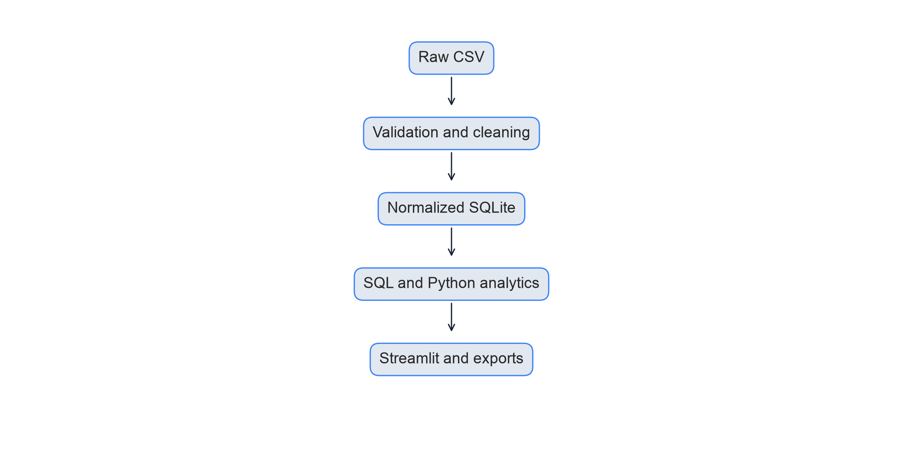
The pipeline resolves data quality centrally before downstream analysis. The calculation layer is independent of Streamlit, allowing the same functions to support charts, Excel, reports and automated checks. The SQL library executes against the committed SQLite snapshot through read-only connections. The presentation layer handles controls, loading, data inspection and downloads.

# 4 Relational design and integrity

Figure 4.2 Four-table relational model and key links

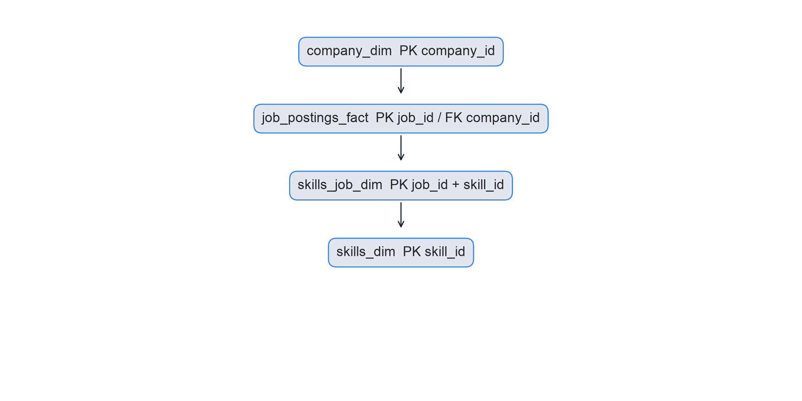
company_dim stores one normalized employer name per company_id. job_postings_fact stores observation attributes and a company foreign key. skills_dim stores unique token names and categories. skills_job_dim links observations and skills using a composite primary key. Indexes on company, search country, date and skill support filters and joins.

Foreign keys are enabled during transactional insertion and checked before publication. A staging database is replaced only after a successful build. The full version directory contains normalized CSVs, the database, cleaned records and the quality report. One atomic current.json pointer selects a complete version. The same checksum does not append repeated observations to the active database.

# 4 Architecture methods and security

## Architecture and methods

# Architecture and methods

Raw CSV → schema validation → exact deduplication → normalized composite deduplication → salary/remote/experience/skill transformation → four relational tables → SQL and Python analytics → Streamlit and exports.

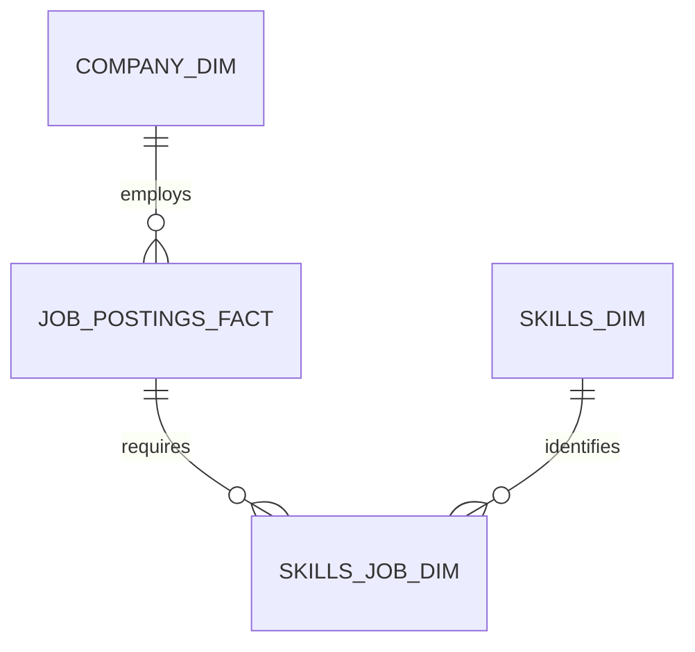

The company dimension has a unique normalized name. Fact rows have a primary key and a company foreign key. The bridge primary key is (job_id, skill_id); a skill is counted once per posting. Country, company and date indexes support analytical access. SQLAlchemy builds a staging SQLite database inside a transaction. PRAGMA foreign_key_check must pass before publication. A complete version directory is published through an atomic current.json pointer. Failed validation leaves the pointer unchanged. Imports with the same checksum replace the same version rather than append duplicate records. Concurrent multiuser imports are not a supported deployment mode.

Global filters intersect dimensions, while multiselect values within one dimension use OR. Skill categories match at least one requested category. Salary range excludes missing salaries only when enabled. Date filters operate on observation dates. SQL Lab explicitly analyses the full snapshot, with a visible scope notice. Quality metrics describe the original snapshot rather than a misleading filtered raw dataset.

Salary resolution prefers salary_standardized, salary_yearly, salary_hourly × 2,080, then an annualized known-unit range midpoint. Unknown source currency prevents verified USD claims. The 15K–400K screen follows the PDF baseline but can remove legitimate part-time or very senior compensation. Excluded candidates and missing indicators remain available for audit. A nonmissing invalid primary source does not silently fall through to a lower-priority source.

Seniority is inferred from title keywords, with managerial keywords taking priority. Default Mid-Level is a methodological assumption rather than verified years of experience. Raw relative posted_at text cannot safely be anchored without source collection semantics; only observation-date trends are shown. Missing remote values are Unknown. Search targets cannot establish the actual global geography of jobs. No remote/onsite test is reported unless both explicitly identified groups contain 30 usable salaries.

Skill rankings show both demand and salary sample size. A salary ranking requires 30 salary observations. Optimal skills require 100 demand observations, 30 usable salaries and mean associated salary at least the overall salary median. These thresholds control small-sample noise, not confounding or causality. Skills can co-occur; category mention counts can exceed job counts.

Security: strict predefined SQL queries, read-only database connections, literal search rather than regex, safe literal skill parsing, upload size and required-column checks, no embedded credentials, and formula-leading strings escaped in Excel. Core functionality uses native Streamlit widgets. Uploads are authorized local operations; deploy behind authentication if exposed to untrusted users. The application binds to loopback by default.

# 5 Dataset description

The source is Luke Barousse’s Data Analyst Job Postings dataset hosted on Kaggle. A genuine local file was found at the user-supplied Downloads location. No substitute production dataset was generated. The application preserves a checksum-named raw copy, records its SHA-256 and stores the exact observation interval in quality.json. Retrieval time is not known for the preexisting local download; processing time is recorded separately and must not be described as source retrieval time.

| Property | Observed value |
| Raw records | 61953 |
| Raw columns | 27 |
| Clean observations | 56004 |
| Observation interval | 2022-11-04 to 2025-04-18 |
| Missing salary candidates | 46974 |
| Screened invalid candidates | 8 |
| Usable salary observations | 9022 |
| License status | Unverified; confirm before public redistribution |

SHA-256: ed3cfff4553b6d462ff0722fc652ce8648f7a56a8157d795f43db4188554bd6a

The actual schema differs from the reference in two material ways. It contains 27 columns rather than the illustrative 24, including source indices and additional descriptive fields. Its range columns use salary_min and salary_max instead of salary_avg_min and salary_avg_max. The pipeline accepts the reference names and explicitly aliases the observed source names.

# 5 Data dictionary

## Data dictionary

| Field | Meaning and method |
| job_id | Surrogate hash of cleaned composite identity and deterministic row order |
| source_job_id | Original Google aggregation identifier retained for audit |
| job_title | Whitespace-normalized casefolded raw title |
| company_name | Casefolded employer name; no external entity resolution |
| company_id | Deterministic snapshot surrogate; not stable across different snapshots |
| location | Title-cased source location; not geocoded |
| job_country | search_location alias; a search target, not a verified workplace country |
| observation_date | UTC date parsed from date_time, the collection timestamp |
| posted_month | Observation month, not verified month of job creation |
| experience_level | Lead/Manager, Senior, Junior/Entry, otherwise Mid-Level (inferred) |
| remote_status | Explicit true Remote, explicit false Onsite, missing/other Unknown |
| salary_candidate | First nonmissing fallback candidate before screening |
| salary_year_avg | Candidate screened to inclusive 15,000–400,000; source currency unverified |
| salary_source | Standardized, yearly, hourly × 2,080, annualized range, or Missing |
| salary_missing | No candidate could be derived |
| salary_valid | Candidate within baseline thresholds; no proof of economic plausibility |
| salary_band | Left-closed bins below 60K, 60–90K, 90–120K, at least 120K |
| currency_status | Unverified source currency; no conversion performed |
| skills | Unique normalized skill tokens, safely parsed from a Python list |
| skill_type | Programming, analyst_tools, databases, cloud, libraries, other |
| platform | via prefix removed; casefolded platform name |
| employment_type | Source schedule_type or Unknown |

# Data dictionary

One cleaned record represents one title/company/location/observation-day combination. It does not necessarily represent a unique vacancy across time.

| Field | Meaning and method |
|---|---|
| job_id | Surrogate hash of cleaned composite identity and deterministic row order |
| source_job_id | Original Google aggregation identifier retained for audit |
| job_title | Whitespace-normalized casefolded raw title |
| company_name | Casefolded employer name; no external entity resolution |
| company_id | Deterministic snapshot surrogate; not stable across different snapshots |
| location | Title-cased source location; not geocoded |
| job_country | search_location alias; a search target, not a verified workplace country |
| observation_date | UTC date parsed from date_time, the collection timestamp |
| posted_month | Observation month, not verified month of job creation |
| experience_level | Lead/Manager, Senior, Junior/Entry, otherwise Mid-Level (inferred) |
| remote_status | Explicit true Remote, explicit false Onsite, missing/other Unknown |
| salary_candidate | First nonmissing fallback candidate before screening |
| salary_year_avg | Candidate screened to inclusive 15,000–400,000; source currency unverified |
| salary_source | Standardized, yearly, hourly × 2,080, annualized range, or Missing |
| salary_missing | No candidate could be derived |
| salary_valid | Candidate within baseline thresholds; no proof of economic plausibility |
| salary_band | Left-closed bins below 60K, 60–90K, 90–120K, at least 120K |
| currency_status | Unverified source currency; no conversion performed |
| skills | Unique normalized skill tokens, safely parsed from a Python list |
| skill_type | Programming, analyst_tools, databases, cloud, libraries, other |
| platform | via prefix removed; casefolded platform name |
| employment_type | Source schedule_type or Unknown |

Raw schema: title, company_name, location, via, description, extensions, job_id, thumbnail, posted_at, schedule_type, work_from_home, salary, search_term, date_time, search_location, commute_time, salary_pay, salary_rate, salary_avg, salary_min, salary_max, salary_hourly, salary_yearly, salary_standardized, description_tokens, and two source index columns.

The reference PDF names salary_avg_min/max; the actual snapshot uses salary_min/max. Range fallback requires known annual/hourly/monthly units. Standardized source salary remains preferred exactly as specified. Missing and invalid salaries are never replaced with zero.

# 5 Raw completeness audit

| Raw field | Missing values |
| Unnamed: 0 | 0 |
| index | 0 |
| title | 0 |
| company_name | 0 |
| location | 37 |
| via | 9 |
| description | 0 |
| extensions | 0 |
| job_id | 0 |
| thumbnail | 23759 |
| posted_at | 190 |
| schedule_type | 246 |
| work_from_home | 33973 |
| salary | 51865 |
| search_term | 0 |
| date_time | 0 |
| search_location | 0 |
| commute_time | 61953 |
| salary_pay | 51865 |
| salary_rate | 51865 |
| salary_avg | 51865 |
| salary_min | 52441 |
| salary_max | 52441 |
| salary_hourly | 56053 |
| salary_yearly | 57884 |
| salary_standardized | 51865 |
| description_tokens | 0 |

Table 5.1 Actual raw-field missingness replaces the source report’s illustrative dataset overview. Salary availability is measured directly rather than assuming two-thirds disclosure. Thumbnail and commute fields are not imputed to support analysis. Raw descriptions remain in the preserved source but are omitted from the compact analytical export to reduce size.

# 6 Data preprocessing methodology

## Validation and text normalization

The input must be a CSV no larger than 350 MiB with title, company_name, location, description_tokens, date_time and search_location. Empty input and missing required fields raise actionable errors. Text columns collapse whitespace; titles and employer names are normalized in case, and locations are title-cased. Platform identifiers have the leading via token removed. These operations make grouping reproducible without pretending to resolve legal employer entities or geocode locations.

## Duplicate strategy

Exact raw duplicates are removed first. After normalization and timestamp parsing, a second pass checks title, employer, location and observation date. The supplied data has zero exact duplicates and 5,949 composite duplicates under this rule. Missing or invalid dates cannot establish reliable composite-date identity and therefore do not cause date-based deletion. Deduplication preserves the first occurrence and does not silently synthesize skill or salary fields from conflicting duplicates.

## Missing values and malformed fields

Unknown salary stays missing. Missing work arrangement becomes Unknown, never Onsite. Invalid timestamps are reported. Safe token parsing accepts bounded literal lists and string tokens only; malformed lists become empty and remain visible in the combined empty/malformed quality count. No unrestricted evaluation, script execution or speculative regular-expression skill recovery is performed.

# 6 Salary resolution and audit

| Priority | Candidate | Assumption |
| 1 | salary_standardized | Use source standardized estimate directly |
| 2 | salary_yearly | Use annual source figure when first is missing |
| 3 | salary_hourly × 2080 | 40 hours × 52 weeks |
| 4 | Range midpoint annualized | Use known annual/hourly/monthly rate only |

The first nonmissing candidate is selected. A nonmissing value outside the screen is preserved as salary_candidate, marked invalid and excluded from salary_year_avg; a lower-priority value is not silently substituted. salary_source records the selected route. The inclusive baseline is 15,000 through 400,000 in source units. This replicates the reference threshold while disclosing that it can remove valid part-time or unusually senior compensation.

The range fallback is deliberately unit-aware. An hourly midpoint is multiplied by 2,080, a monthly midpoint by 12 and a yearly midpoint by one. An unknown rate does not justify annualization. No currency conversion is performed because the CSV lacks a verified currency field. All charts and exports label monetary values as unverified source units rather than USD.

salary_missing distinguishes an unavailable candidate from an invalid one. The current snapshot has 46,974 missing candidates and eight screened invalid candidates. The valid subset therefore contains 9,022 values. Salary bands use left-closed intervals below 60K, 60–90K, 90–120K and at least 120K. Missing salary has no assigned band.

# 6 Feature engineering and pipeline quality

Figure 6.1 Counts measured before and after cleaning

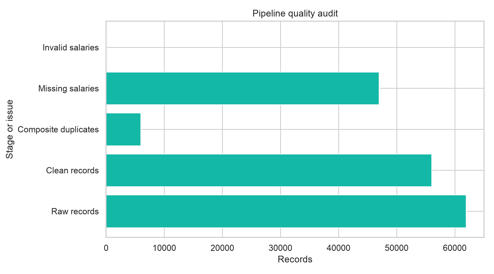
Seniority is derived from title keywords. Lead/Manager takes priority, followed by Senior and Junior/Entry. Unmatched titles receive Mid-Level (inferred), explicitly exposing the default assumption. Skills are unique within an observation and categorized into programming, analyst tools, databases, cloud, libraries or other. Category membership is a documented vocabulary and can be extended; it does not identify every synonym.

Observation year and month derive from date_time. They are retained for historical collection trends and do not establish original posting creation dates. Country is retained as the search target and is not relabelled verified global job location. Each version includes raw and cleaned completeness counts, processing time, source URL, checksum and explicit license/currency limitations.

# 7 Salary exploratory analysis

Figure 7.1 Distribution of 9,022 screened annual salary candidates

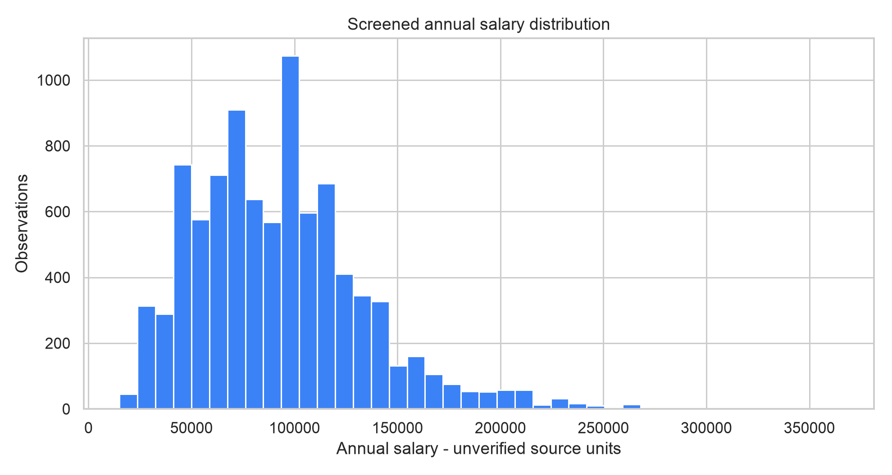
The valid salary subset has a median of 88,400 and a mean of approximately 92,131 in unverified source units. Mean exceeding median is consistent with an upper tail, but exact shape is shown through the histogram and percentile table rather than assumed for every filtered group. Non-disclosure is extensive, so the distribution cannot be interpreted as the compensation distribution of all observed roles.

The salary page adds box plots by inferred experience, group mean/median comparisons and screening audit records. Group charts require at least 30 valid salary observations. Skill comparisons can overlap because a job can request several skills; this prevents interpreting the displayed difference as a standalone skill premium.

# 7 Skill demand analysis

Figure 7.2 Actual top 15 extracted skills by observation count

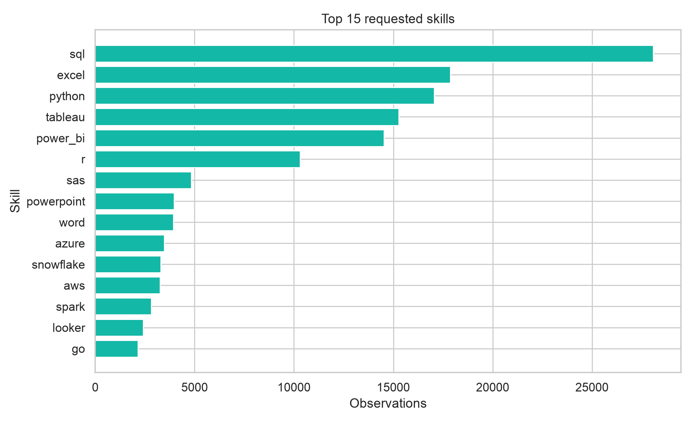
Skill demand counts distinct observations containing a token, not raw token appearances. The bridge composite key ensures repeated tokens in the source do not inflate frequency. Both demand and salary sample count are reported. A skill can be common but poorly represented in disclosed salaries, so demand and salary evidence must be inspected together.

The optimal-skill heuristic requires at least 100 demand observations, 30 valid salary observations and mean associated salary at least the overall median. The scatter and candidate table make this rule visible. Co-occurrence counts jobs containing two distinct tokens; diagonal cells show each skill’s own count. These relationships describe extracted requirements rather than causal learning returns.

# 7 Experience analysis

Figure 7.3 Observation volume by inferred experience

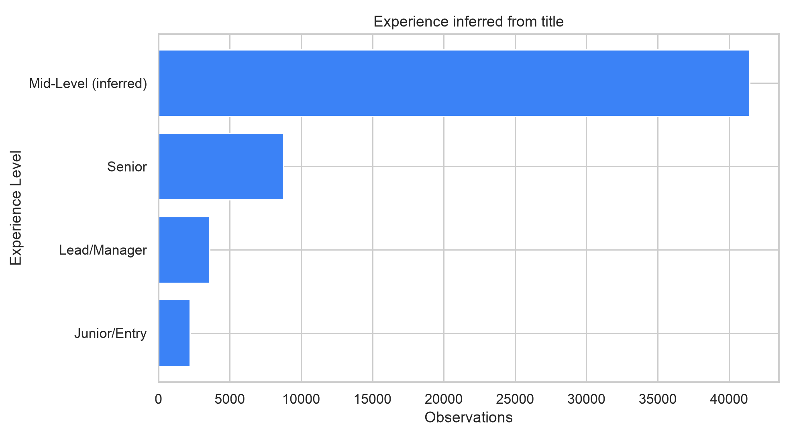
Title classification provides a practical but imperfect view of seniority. The unmatched default is visibly marked inferred. The SQL baseline comparison computes a descriptive salary differential relative to this category, without treating it as a controlled return to experience.

# 7 Employer analysis

Figure 7.4 Highest-volume normalized employer names

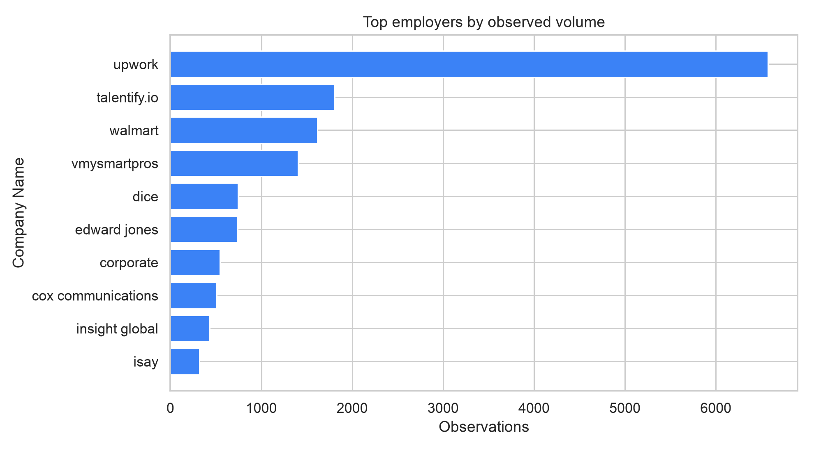
Employer counts can reflect reposting and intermediary platforms as well as demand. Normalization combines case variants but does not establish corporate family membership. Salary rankings require a valid disclosed sample and should be examined alongside the number of observations.

# 7 Geographic analysis

Figure 7.5 Search-target coverage in the supplied snapshot

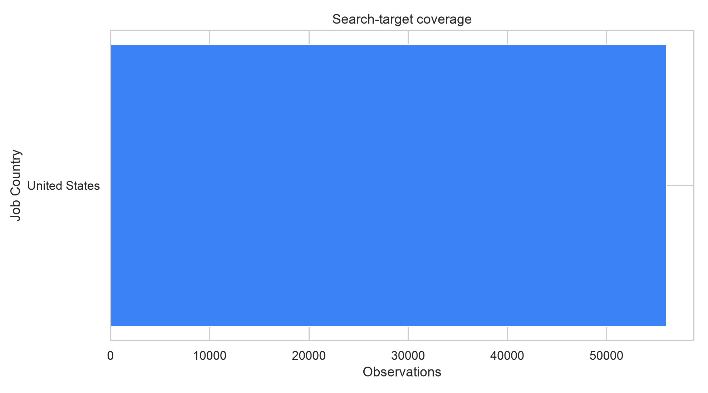
Every search target is United States. The map is therefore explicitly a search-coverage map, not global vacancy geography. Location strings remain available for inspection, but no invented country identity or coordinates are inferred.

# 7 Work arrangement analysis

Figure 7.6 Explicit remote versus unknown observations

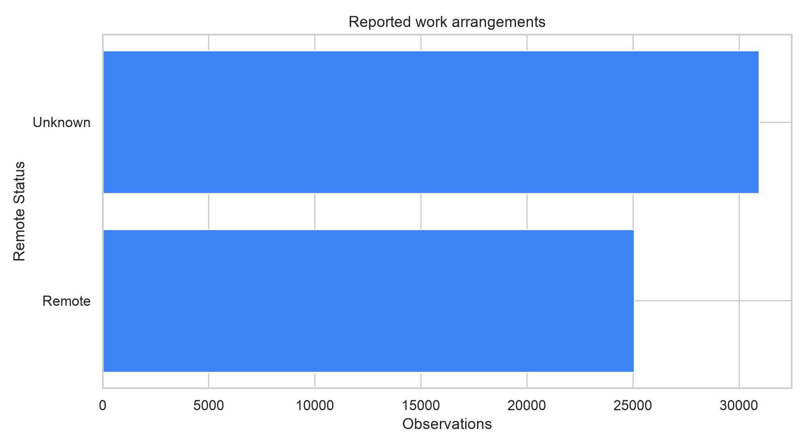
The source contains true remote flags and missing values. Unknown records cannot be used as an onsite comparison group. The application displays the categories separately and suppresses an unjustified remote-versus-onsite statistical test.

# 7 Observation trends

Figure 7.7 Monthly collection activity

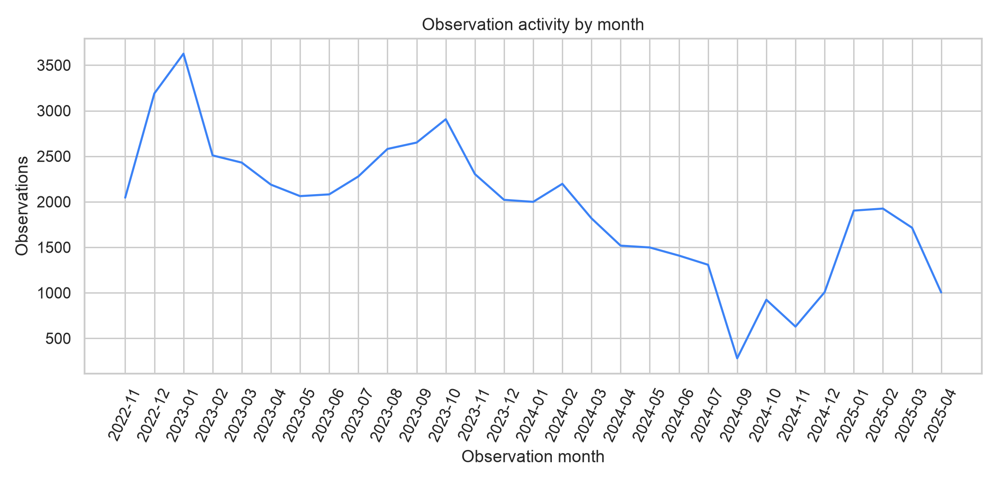
Observation changes may reflect collection schedules, repeated listings and coverage gaps. LAG calculates relative changes in these counts, but a high percentage is not evidence of proportional growth in newly created vacancies.

# 8 SQL analytical casebook

The following 38 questions were executed against the actual committed SQLite database. Each case includes the business question, complete SQL, observed output schema, a short sample, elapsed execution time and interpretation limits. Full CSV result sets are stored separately in Report/query_01.csv through Report/query_38.csv. Tests confirm execution and independently reconcile headline counts and median; execution success alone does not prove every possible business interpretation.

All statements use the predefined query library. Database connections are read-only and query_only is enabled. Users select questions rather than submit arbitrary SQL. Queries operate on the complete committed snapshot, a scope explicitly shown in the application. Global page filters apply to interactive analytical pages, while the SQL Lab retains this documented full-snapshot scope.

The query library covers filtering, grouping, HAVING, inner and outer joins, nested queries, CTEs, conditional aggregation, ranking, ROW_NUMBER, NTILE, LAG, co-occurrence and median. Source-country and currency limitations carry through every query. NULL salary candidates are excluded from salary aggregates, and bridge joins use the appropriate grain for their business question.

# 8 Query 01 How many postings are in the snapshot

Business purpose: How many postings are in the snapshot?

```sql
SELECT COUNT(*) AS postings FROM job_postings_fact
```

Execution evidence: passed; 1 output rows; 0.0101 seconds in the recorded local run. Output file: Report/query_01.csv.

| postings |
| 56004 |

Table 8.1 Recorded result sample. Full rows and precision remain in the CSV.

Interpretation and limitations: Check the stated grouping before adding totals. Unknown values remain unknown and do not establish that an attribute is absent.

## 8 Query 02 How many distinct companies

Business purpose: How many distinct companies?

```sql
SELECT COUNT(*) AS companies FROM company_dim
```

Execution evidence: passed; 1 output rows; 0.0004 seconds in the recorded local run. Output file: Report/query_02.csv.

| companies |
| 13177 |

Table 8.2 Recorded result sample. Full rows and precision remain in the CSV.

Interpretation and limitations: Employer normalization does not establish legal-entity relationships. Observed listing volume can reflect intermediaries, syndication and reposting rather than successful hires.

# 8 Query 03 Which search countries are represented

Business purpose: Which search countries are represented?

```sql
SELECT job_country, COUNT(*) postings FROM job_postings_fact GROUP BY job_country
```

Execution evidence: passed; 1 output rows; 0.0019 seconds in the recorded local run. Output file: Report/query_03.csv.

| job_country | postings |
| United States | 56004 |

Table 8.3 Recorded result sample. Full rows and precision remain in the CSV.

Interpretation and limitations: Check the stated grouping before adding totals. Unknown values remain unknown and do not establish that an attribute is absent.

## 8 Query 04 How many unique skills

Business purpose: How many unique skills?

```sql
SELECT COUNT(*) skills FROM skills_dim
```

Execution evidence: passed; 1 output rows; 0.0003 seconds in the recorded local run. Output file: Report/query_04.csv.

| skills |
| 134 |

Table 8.4 Recorded result sample. Full rows and precision remain in the CSV.

Interpretation and limitations: Skill totals overlap because one observation can request several skills. Salary evidence describes a disclosed subset, and association does not establish the causal value of learning a skill.

# 8 Query 05 What is the mean valid salary

Business purpose: What is the mean valid salary?

```sql
SELECT AVG(salary_year_avg) mean_salary,COUNT(salary_year_avg) salary_n FROM job_postings_fact
```

Execution evidence: passed; 1 output rows; 0.0039 seconds in the recorded local run. Output file: Report/query_05.csv.

| mean_salary | salary_n |
| 92,131.04 | 9022 |

Table 8.5 Recorded result sample. Full rows and precision remain in the CSV.

Interpretation and limitations: Salary results exclude missing and invalid candidates. Check sample counts and provenance; source currency is unverified, with no causal, inflation or conversion adjustment.

## 8 Query 06 What is the median valid salary

Business purpose: What is the median valid salary?

```sql
WITH ranked AS (SELECT salary_year_avg,ROW_NUMBER() OVER(ORDER BY salary_year_avg) rn,COUNT(*) OVER() n FROM job_postings_fact WHERE salary_year_avg IS NOT NULL) SELECT AVG(salary_year_avg) median_salary FROM ranked WHERE rn IN ((n+1)/2,(n+2)/2)
```

Execution evidence: passed; 1 output rows; 0.0085 seconds in the recorded local run. Output file: Report/query_06.csv.

| median_salary |
| 88400.0 |

Table 8.6 Recorded result sample. Full rows and precision remain in the CSV.

Interpretation and limitations: Salary results exclude missing and invalid candidates. Check sample counts and provenance; source currency is unverified, with no causal, inflation or conversion adjustment.

# 8 Query 07 What share has usable salary

Business purpose: What share has usable salary?

```sql
SELECT 100.0*COUNT(salary_year_avg)/NULLIF(COUNT(*),0) usable_pct FROM job_postings_fact
```

Execution evidence: passed; 1 output rows; 0.0035 seconds in the recorded local run. Output file: Report/query_07.csv.

| usable_pct |
| 16.11 |

Table 8.7 Recorded result sample. Full rows and precision remain in the CSV.

Interpretation and limitations: Salary results exclude missing and invalid candidates. Check sample counts and provenance; source currency is unverified, with no causal, inflation or conversion adjustment.

## 8 Query 08 How are work arrangements reported

Business purpose: How are work arrangements reported?

```sql
SELECT remote_status,COUNT(*) postings FROM job_postings_fact GROUP BY remote_status
```

Execution evidence: passed; 2 output rows; 0.0081 seconds in the recorded local run. Output file: Report/query_08.csv.

| remote_status | postings |
| Remote | 25053 |
| Unknown | 30951 |

Table 8.8 Recorded result sample. Full rows and precision remain in the CSV.

Interpretation and limitations: Check the stated grouping before adding totals. Unknown values remain unknown and do not establish that an attribute is absent.

# 8 Query 09 What are the most recent observations

Business purpose: What are the most recent observations?

```sql
SELECT job_id,job_title,observation_date FROM job_postings_fact ORDER BY observation_date DESC LIMIT 50
```

Execution evidence: passed; 50 output rows; 0.0003 seconds in the recorded local run. Output file: Report/query_09.csv.

| job_id | job_title | observation_date |
| 229df84fe4324c10d47c0abc | workday system function technical an | 2025-04-18 |
| 533c016764cc9f45c5ebfee7 | architecture support analyst | 2025-04-18 |
| c879d33aa63448b4bc481b90 | business performance analyst | 2025-04-18 |
| 6c497c5b3a0b4cacc4343545 | provisioning analyst | 2025-04-18 |

Table 8.9 Recorded result sample. Full rows and precision remain in the CSV.

Interpretation and limitations: Dates are collection timestamps. Coverage changes and repeated listings affect observed trends; these are neither verified new vacancies nor forecasts.

## 8 Query 10 How do volume and salary vary by experience

Business purpose: How do volume and salary vary by experience?

```sql
SELECT experience_level,COUNT(*) postings,COUNT(salary_year_avg) salary_n,AVG(salary_year_avg) mean_salary FROM job_postings_fact GROUP BY experience_level ORDER BY postings DESC
```

Execution evidence: passed; 4 output rows; 0.0137 seconds in the recorded local run. Output file: Report/query_10.csv.

| experience_level | postings | salary_n | mean_salary |
| Mid-Level (inferred) | 41438 | 7053 | 89,044.24 |
| Senior | 8772 | 1262 | 107,139.70 |
| Lead/Manager | 3579 | 413 | 123,463.23 |
| Junior/Entry | 2215 | 294 | 57,743.63 |

Table 8.10 Recorded result sample. Full rows and precision remain in the CSV.

Interpretation and limitations: Salary results exclude missing and invalid candidates. Check sample counts and provenance; source currency is unverified, with no causal, inflation or conversion adjustment.

# 8 Query 11 How do volume and salary vary by search geography

Business purpose: How do volume and salary vary by search geography?

```sql
SELECT job_country,COUNT(*) postings,COUNT(salary_year_avg) salary_n,AVG(salary_year_avg) mean_salary FROM job_postings_fact GROUP BY job_country ORDER BY postings DESC
```

Execution evidence: passed; 1 output rows; 0.0060 seconds in the recorded local run. Output file: Report/query_11.csv.

| job_country | postings | salary_n | mean_salary |
| United States | 56004 | 9022 | 92,131.04 |

Table 8.11 Recorded result sample. Full rows and precision remain in the CSV.

Interpretation and limitations: Salary results exclude missing and invalid candidates. Check sample counts and provenance; source currency is unverified, with no causal, inflation or conversion adjustment.

## 8 Query 12 How do volume and salary vary by employment type

Business purpose: How do volume and salary vary by employment type?

```sql
SELECT employment_type,COUNT(*) postings,COUNT(salary_year_avg) salary_n,AVG(salary_year_avg) mean_salary FROM job_postings_fact GROUP BY employment_type ORDER BY postings DESC
```

Execution evidence: passed; 33 output rows; 0.0106 seconds in the recorded local run. Output file: Report/query_12.csv.

| employment_type | postings | salary_n | mean_salary |
| Full-time | 41018 | 4369 | 99,413.02 |
| Contractor | 8274 | 2689 | 92,323.11 |
| Contractor and Temp work | 2677 | 1161 | 82,960.93 |
| Part-time | 1092 | 89 | 82,363.47 |

Table 8.12 Recorded result sample. Full rows and precision remain in the CSV.

Interpretation and limitations: Salary results exclude missing and invalid candidates. Check sample counts and provenance; source currency is unverified, with no causal, inflation or conversion adjustment.

# 8 Query 13 How do volume and salary vary by platform

Business purpose: How do volume and salary vary by platform?

```sql
SELECT platform,COUNT(*) postings,COUNT(salary_year_avg) salary_n,AVG(salary_year_avg) mean_salary FROM job_postings_fact GROUP BY platform ORDER BY postings DESC
```

Execution evidence: passed; 922 output rows; 0.0113 seconds in the recorded local run. Output file: Report/query_13.csv.

| platform | postings | salary_n | mean_salary |
| linkedin | 20066 | 2002 | 110,846.33 |
| bebee | 7538 | 266 | 85,281.95 |
| upwork | 6546 | 3140 | 83,672.37 |
| ziprecruiter | 2916 | 590 | 89,653.72 |

Table 8.13 Recorded result sample. Full rows and precision remain in the CSV.

Interpretation and limitations: Salary results exclude missing and invalid candidates. Check sample counts and provenance; source currency is unverified, with no causal, inflation or conversion adjustment.

## 8 Query 14 How do volume and salary vary by salary band

Business purpose: How do volume and salary vary by salary band?

```sql
SELECT salary_band,COUNT(*) postings,COUNT(salary_year_avg) salary_n,AVG(salary_year_avg) mean_salary FROM job_postings_fact GROUP BY salary_band ORDER BY postings DESC
```

Execution evidence: passed; 5 output rows; 0.0093 seconds in the recorded local run. Output file: Report/query_14.csv.

| salary_band | postings | salary_n | mean_salary |
|  | 46982 | 0 |  |
| 60–90K | 2580 | 2580 | 73,532.37 |
| 90–120K | 2569 | 2569 | 104,111.45 |
| <60K | 2002 | 2002 | 43,820.16 |

Table 8.14 Recorded result sample. Full rows and precision remain in the CSV.

Interpretation and limitations: Salary results exclude missing and invalid candidates. Check sample counts and provenance; source currency is unverified, with no causal, inflation or conversion adjustment.

# 8 Query 15 How do volume and salary vary by arrangement

Business purpose: How do volume and salary vary by arrangement?

```sql
SELECT remote_status,COUNT(*) postings,COUNT(salary_year_avg) salary_n,AVG(salary_year_avg) mean_salary FROM job_postings_fact GROUP BY remote_status ORDER BY postings DESC
```

Execution evidence: passed; 2 output rows; 0.0095 seconds in the recorded local run. Output file: Report/query_15.csv.

| remote_status | postings | salary_n | mean_salary |
| Unknown | 30951 | 3459 | 91,856.62 |
| Remote | 25053 | 5563 | 92,301.68 |

Table 8.15 Recorded result sample. Full rows and precision remain in the CSV.

Interpretation and limitations: Salary results exclude missing and invalid candidates. Check sample counts and provenance; source currency is unverified, with no causal, inflation or conversion adjustment.

## 8 Query 16 Which companies hire most

Business purpose: Which companies hire most?

```sql
SELECT c.company_name,COUNT(*) postings,RANK() OVER(ORDER BY COUNT(*) DESC) company_rank FROM job_postings_fact j JOIN company_dim c ON j.company_id=c.company_id GROUP BY c.company_id ORDER BY postings DESC
```

Execution evidence: passed; 13,177 output rows; 0.0147 seconds in the recorded local run. Output file: Report/query_16.csv.

| company_name | postings | company_rank |
| upwork | 6572 | 1 |
| talentify.io | 1806 | 2 |
| walmart | 1617 | 3 |
| vmysmartpros | 1406 | 4 |

Table 8.16 Recorded result sample. Full rows and precision remain in the CSV.

Interpretation and limitations: Employer normalization does not establish legal-entity relationships. Observed listing volume can reflect intermediaries, syndication and reposting rather than successful hires.

# 8 Query 17 Which companies have salary evidence from 30 or more jobs

Business purpose: Which companies have salary evidence from 30 or more jobs?

```sql
SELECT c.company_name,COUNT(j.salary_year_avg) salary_n,AVG(j.salary_year_avg) mean_salary FROM company_dim c JOIN job_postings_fact j ON c.company_id=j.company_id GROUP BY c.company_id HAVING COUNT(j.salary_year_avg)>=30 ORDER BY mean_salary DESC
```

Execution evidence: passed; 16 output rows; 0.0273 seconds in the recorded local run. Output file: Report/query_17.csv.

| company_name | salary_n | mean_salary |
| harnham | 70 | 132,237.14 |
| edward jones | 156 | 111,280.50 |
| walmart | 56 | 109312.5 |
| insight global | 147 | 102,430.38 |

Table 8.17 Recorded result sample. Full rows and precision remain in the CSV.

Interpretation and limitations: Salary results exclude missing and invalid candidates. Check sample counts and provenance; source currency is unverified, with no causal, inflation or conversion adjustment.

## 8 Query 18 Which skills are most demanded

Business purpose: Which skills are most demanded?

```sql
SELECT s.skill,COUNT(*) demand FROM skills_job_dim b JOIN skills_dim s ON b.skill_id=s.skill_id GROUP BY s.skill_id ORDER BY demand DESC
```

Execution evidence: passed; 134 output rows; 0.0046 seconds in the recorded local run. Output file: Report/query_18.csv.

| skill | demand |
| sql | 28081 |
| excel | 17867 |
| python | 17050 |
| tableau | 15266 |

Table 8.18 Recorded result sample. Full rows and precision remain in the CSV.

Interpretation and limitations: Skill totals overlap because one observation can request several skills. Salary evidence describes a disclosed subset, and association does not establish the causal value of learning a skill.

# 8 Query 19 Which skills have high observed salaries

Business purpose: Which skills have high observed salaries?

```sql
SELECT s.skill,COUNT(j.salary_year_avg) salary_n,AVG(j.salary_year_avg) mean_salary FROM skills_dim s JOIN skills_job_dim b ON s.skill_id=b.skill_id JOIN job_postings_fact j ON b.job_id=j.job_id GROUP BY s.skill_id HAVING COUNT(j.salary_year_avg)>=30 ORDER BY mean_salary DESC
```

Execution evidence: passed; 66 output rows; 0.0803 seconds in the recorded local run. Output file: Report/query_19.csv.

| skill | salary_n | mean_salary |
| pytorch | 61 | 129,783.10 |
| pyspark | 69 | 128,708.33 |
| airflow | 68 | 127,965.06 |
| docker | 67 | 127,862.16 |

Table 8.19 Recorded result sample. Full rows and precision remain in the CSV.

Interpretation and limitations: Skill totals overlap because one observation can request several skills. Salary evidence describes a disclosed subset, and association does not establish the causal value of learning a skill.

# 8 Query 20 Which skills are optimal under the defined rule

Business purpose: Which skills are optimal under the defined rule?

```sql
WITH demand AS (SELECT s.skill,COUNT(*) demand,COUNT(j.salary_year_avg) salary_n,AVG(j.salary_year_avg) mean_salary FROM skills_dim s JOIN skills_job_dim b ON s.skill_id=b.skill_id JOIN job_postings_fact j ON j.job_id=b.job_id GROUP BY s.skill_id), r AS (SELECT salary_year_avg,ROW_NUMBER() OVER(ORDER BY salary_year_avg) rn,COUNT(*) OVER() n FROM job_postings_fact WHERE salary_year_avg IS NOT NULL), med AS (SELECT AVG(salary_year_avg) v FROM r WHERE rn IN ((n+1)/2,(n+2)/2)) SELECT * FROM demand WHERE demand>=100 AND salary_n>=30 AND mean_salary>=(SELECT v FROM med) ORDER BY mean_salary DESC
```

Execution evidence: passed; 53 output rows; 0.0886 seconds in the recorded local run. Output file: Report/query_20.csv.

| skill | demand | salary_n | mean_salary |
| pytorch | 431 | 61 | 129,783.10 |
| pyspark | 585 | 69 | 128,708.33 |
| airflow | 576 | 68 | 127,965.06 |
| docker | 457 | 67 | 127,862.16 |

Table 8.20 Recorded result sample. Full rows and precision remain in the CSV.

Interpretation and limitations: Skill totals overlap because one observation can request several skills. Salary evidence describes a disclosed subset, and association does not establish the causal value of learning a skill.

# 8 Query 21 Which skill pairs co-occur most

Business purpose: Which skill pairs co-occur most?

```sql
SELECT s.skill skill_a,t.skill skill_b,COUNT(*) pair_count FROM skills_job_dim a JOIN skills_job_dim b ON a.job_id=b.job_id AND a.skill_id<b.skill_id JOIN skills_dim s ON s.skill_id=a.skill_id JOIN skills_dim t ON t.skill_id=b.skill_id GROUP BY a.skill_id,b.skill_id ORDER BY pair_count DESC LIMIT 30
```

Execution evidence: passed; 30 output rows; 0.3168 seconds in the recorded local run. Output file: Report/query_21.csv.

| skill_a | skill_b | pair_count |
| python | sql | 13512 |
| sql | tableau | 12205 |
| power_bi | sql | 10817 |
| excel | sql | 10520 |

Table 8.21 Recorded result sample. Full rows and precision remain in the CSV.

Interpretation and limitations: Skill totals overlap because one observation can request several skills. Salary evidence describes a disclosed subset, and association does not establish the causal value of learning a skill.

## 8 Query 22 What is the top-paying job per company

Business purpose: What is the top-paying job per company?

```sql
WITH r AS (SELECT *,ROW_NUMBER() OVER(PARTITION BY company_id ORDER BY salary_year_avg DESC,job_id) rn FROM job_postings_fact WHERE salary_year_avg IS NOT NULL) SELECT company_id,job_title,salary_year_avg FROM r WHERE rn=1
```

Execution evidence: passed; 2,318 output rows; 0.0367 seconds in the recorded local run. Output file: Report/query_22.csv.

| company_id | job_title | salary_year_avg |
| 1 | data analyst (hybrid, 1+ yrs exp req | 67500.0 |
| 11 | business intelligence analyst [70647 | 93600.0 |
| 12 | healthcare data analyst | 119600.0 |
| 22 | healthcare data analyst | 70000.0 |

Table 8.22 Recorded result sample. Full rows and precision remain in the CSV.

Interpretation and limitations: Employer normalization does not establish legal-entity relationships. Observed listing volume can reflect intermediaries, syndication and reposting rather than successful hires.

# 8 Query 23 What salary quartile contains each disclosed posting

Business purpose: What salary quartile contains each disclosed posting?

```sql
SELECT job_id,salary_year_avg,NTILE(4) OVER(ORDER BY salary_year_avg) salary_quartile FROM job_postings_fact WHERE salary_year_avg IS NOT NULL
```

Execution evidence: passed; 9,022 output rows; 0.0113 seconds in the recorded local run. Output file: Report/query_23.csv.

| job_id | salary_year_avg | salary_quartile |
| 163c3e28c32092b6ea92cb8f | 15080.0 | 1 |
| 1869af9db3a9f6008366af2c | 18720.0 | 1 |
| 614bd29642c01194a355172f | 18720.0 | 1 |
| 6a6d84549428b9053760c439 | 18720.0 | 1 |

Table 8.23 Recorded result sample. Full rows and precision remain in the CSV.

Interpretation and limitations: Salary results exclude missing and invalid candidates. Check sample counts and provenance; source currency is unverified, with no causal, inflation or conversion adjustment.

## 8 Query 24 How does monthly observed volume change

Business purpose: How does monthly observed volume change?

```sql
WITH m AS (SELECT posted_month,COUNT(*) postings FROM job_postings_fact WHERE posted_month IS NOT NULL GROUP BY posted_month),t AS (SELECT *,LAG(postings) OVER(ORDER BY posted_month) previous FROM m) SELECT *,100.0*(postings-previous)/NULLIF(previous,0) change_pct FROM t
```

Execution evidence: passed; 29 output rows; 0.0105 seconds in the recorded local run. Output file: Report/query_24.csv.

| posted_month | postings | previous | change_pct |
| 2022-11 | 2045 |  |  |
| 2022-12 | 3189 | 2045.0 | 55.94 |
| 2023-01 | 3626 | 3189.0 | 13.70 |
| 2023-02 | 2509 | 3626.0 | -30.81 |

Table 8.24 Recorded result sample. Full rows and precision remain in the CSV.

Interpretation and limitations: Dates are collection timestamps. Coverage changes and repeated listings affect observed trends; these are neither verified new vacancies nor forecasts.

# 8 Query 25 What is the observed seniority differential

Business purpose: What is the observed seniority differential?

```sql
WITH g AS (SELECT experience_level,AVG(salary_year_avg) mean_salary,COUNT(salary_year_avg) salary_n FROM job_postings_fact GROUP BY experience_level) SELECT *,100*(mean_salary/(SELECT mean_salary FROM g WHERE experience_level='Mid-Level (inferred)')-1) differential_pct FROM g
```

Execution evidence: passed; 4 output rows; 0.0137 seconds in the recorded local run. Output file: Report/query_25.csv.

| experience_level | mean_salary | salary_n | differential_pct |
| Junior/Entry | 57,743.63 | 294 | -35.15 |
| Lead/Manager | 123,463.23 | 413 | 38.65 |
| Mid-Level (inferred) | 89,044.24 | 7053 | 0.0 |
| Senior | 107,139.70 | 1262 | 20.32 |

Table 8.25 Recorded result sample. Full rows and precision remain in the CSV.

Interpretation and limitations: Dates are collection timestamps. Coverage changes and repeated listings affect observed trends; these are neither verified new vacancies nor forecasts.

## 8 Query 26 Which jobs have no parsed skills

Business purpose: Which jobs have no parsed skills?

```sql
SELECT j.job_id,j.job_title FROM job_postings_fact j LEFT JOIN skills_job_dim b ON j.job_id=b.job_id WHERE b.job_id IS NULL
```

Execution evidence: passed; 12,085 output rows; 0.0563 seconds in the recorded local run. Output file: Report/query_26.csv.

| job_id | job_title |
| f4b5927ec7daf1f71b12204a | data analyst |
| caabed29a09c14004faedf94 | it financial data analyst lead |
| fbda1bec058e737ee3d0e60f | google tag manager |
| 2323a4d1d29a00098b446f72 | associate research/data analyst-ces  |

Table 8.26 Recorded result sample. Full rows and precision remain in the CSV.

Interpretation and limitations: Skill totals overlap because one observation can request several skills. Salary evidence describes a disclosed subset, and association does not establish the causal value of learning a skill.

# 8 Query 27 How many jobs require each skill category

Business purpose: How many jobs require each skill category?

```sql
SELECT s.skill_type,COUNT(DISTINCT b.job_id) postings FROM skills_dim s JOIN skills_job_dim b ON s.skill_id=b.skill_id GROUP BY s.skill_type
```

Execution evidence: passed; 6 output rows; 0.0998 seconds in the recorded local run. Output file: Report/query_27.csv.

| skill_type | postings |
| analyst_tools | 30738 |
| cloud | 7282 |
| databases | 4459 |
| libraries | 1926 |

Table 8.27 Recorded result sample. Full rows and precision remain in the CSV.

Interpretation and limitations: Skill totals overlap because one observation can request several skills. Salary evidence describes a disclosed subset, and association does not establish the causal value of learning a skill.

## 8 Query 28 Which jobs exceed the snapshot mean salary

Business purpose: Which jobs exceed the snapshot mean salary?

```sql
SELECT job_id,salary_year_avg FROM job_postings_fact WHERE salary_year_avg>(SELECT AVG(salary_year_avg) FROM job_postings_fact) ORDER BY salary_year_avg DESC
```

Execution evidence: passed; 4,279 output rows; 0.0081 seconds in the recorded local run. Output file: Report/query_28.csv.

| job_id | salary_year_avg |
| a7f270171b44d3c8193e230d | 364000.0 |
| 535ae6c6ec9e8cd5969db665 | 322400.0 |
| aacb0005d20dde1dd43eaf1f | 312000.0 |
| 5ebd556e11097187abc5c02e | 312000.0 |

Table 8.28 Recorded result sample. Full rows and precision remain in the CSV.

Interpretation and limitations: Salary results exclude missing and invalid candidates. Check sample counts and provenance; source currency is unverified, with no causal, inflation or conversion adjustment.

# 8 Query 29 How many remote jobs does each company report

Business purpose: How many remote jobs does each company report?

```sql
SELECT company_id,SUM(CASE WHEN remote_status='Remote' THEN 1 ELSE 0 END) remote_jobs,SUM(CASE WHEN remote_status='Unknown' THEN 1 ELSE 0 END) unknown_jobs,COUNT(*) postings FROM job_postings_fact GROUP BY company_id
```

Execution evidence: passed; 13,177 output rows; 0.0362 seconds in the recorded local run. Output file: Report/query_29.csv.

| company_id | remote_jobs | unknown_jobs | postings |
| 1 | 0 | 7 | 7 |
| 2 | 0 | 5 | 5 |
| 3 | 1 | 0 | 1 |
| 4 | 0 | 3 | 3 |

Table 8.29 Recorded result sample. Full rows and precision remain in the CSV.

Interpretation and limitations: Employer normalization does not establish legal-entity relationships. Observed listing volume can reflect intermediaries, syndication and reposting rather than successful hires.

## 8 Query 30 How are annual salaries derived

Business purpose: How are annual salaries derived?

```sql
SELECT salary_source,COUNT(*) postings,COUNT(salary_year_avg) valid_salaries FROM job_postings_fact GROUP BY salary_source
```

Execution evidence: passed; 2 output rows; 0.0098 seconds in the recorded local run. Output file: Report/query_30.csv.

| salary_source | postings | valid_salaries |
| Missing | 46974 | 0 |
| salary_standardized | 9030 | 9022 |

Table 8.30 Recorded result sample. Full rows and precision remain in the CSV.

Interpretation and limitations: Check the stated grouping before adding totals. Unknown values remain unknown and do not establish that an attribute is absent.

# 8 Query 31 How many candidate salaries fail screening

Business purpose: How many candidate salaries fail screening?

```sql
SELECT COUNT(*) invalid_salary FROM job_postings_fact WHERE salary_missing=0 AND salary_valid=0
```

Execution evidence: passed; 1 output rows; 0.0037 seconds in the recorded local run. Output file: Report/query_31.csv.

| invalid_salary |
| 8 |

Table 8.31 Recorded result sample. Full rows and precision remain in the CSV.

Interpretation and limitations: Check the stated grouping before adding totals. Unknown values remain unknown and do not establish that an attribute is absent.

## 8 Query 32 Which locations have the most observations

Business purpose: Which locations have the most observations?

```sql
SELECT location,COUNT(*) postings FROM job_postings_fact GROUP BY location ORDER BY postings DESC LIMIT 30
```

Execution evidence: passed; 30 output rows; 0.0096 seconds in the recorded local run. Output file: Report/query_32.csv.

| location | postings |
| Anywhere | 25055 |
| United States | 14013 |
| Oklahoma City, Ok | 1276 |
| Kansas City, Mo | 1273 |

Table 8.32 Recorded result sample. Full rows and precision remain in the CSV.

Interpretation and limitations: Dates are collection timestamps. Coverage changes and repeated listings affect observed trends; these are neither verified new vacancies nor forecasts.

# 8 Query 33 Which companies have no usable salary observations

Business purpose: Which companies have no usable salary observations?

```sql
SELECT c.company_name FROM company_dim c LEFT JOIN job_postings_fact j ON c.company_id=j.company_id GROUP BY c.company_id HAVING COUNT(j.salary_year_avg)=0
```

Execution evidence: passed; 10,859 output rows; 0.0319 seconds in the recorded local run. Output file: Report/query_33.csv.

| company_name |
| (unknown company) |
| *us amr-jones lang lasalle americas, |
| 00002 citibank, n.a. |
| 001 stride, inc. |

Table 8.33 Recorded result sample. Full rows and precision remain in the CSV.

Interpretation and limitations: Salary results exclude missing and invalid candidates. Check sample counts and provenance; source currency is unverified, with no causal, inflation or conversion adjustment.

## 8 Query 34 How many skills are requested per posting

Business purpose: How many skills are requested per posting?

```sql
WITH n AS (SELECT j.job_id,COUNT(b.skill_id) skill_count FROM job_postings_fact j LEFT JOIN skills_job_dim b ON j.job_id=b.job_id GROUP BY j.job_id) SELECT skill_count,COUNT(*) postings FROM n GROUP BY skill_count ORDER BY skill_count
```

Execution evidence: passed; 26 output rows; 0.0290 seconds in the recorded local run. Output file: Report/query_34.csv.

| skill_count | postings |
| 0 | 12085 |
| 1 | 7423 |
| 2 | 7352 |
| 3 | 6850 |

Table 8.34 Recorded result sample. Full rows and precision remain in the CSV.

Interpretation and limitations: Skill totals overlap because one observation can request several skills. Salary evidence describes a disclosed subset, and association does not establish the causal value of learning a skill.

# 8 Query 35 Which skills appear in reported remote roles

Business purpose: Which skills appear in reported remote roles?

```sql
SELECT s.skill,COUNT(*) postings FROM skills_dim s JOIN skills_job_dim b ON s.skill_id=b.skill_id JOIN job_postings_fact j ON j.job_id=b.job_id WHERE j.remote_status='Remote' GROUP BY s.skill_id ORDER BY postings DESC
```

Execution evidence: passed; 129 output rows; 0.0358 seconds in the recorded local run. Output file: Report/query_35.csv.

| skill | postings |
| sql | 12208 |
| python | 7585 |
| excel | 7130 |
| tableau | 6121 |

Table 8.35 Recorded result sample. Full rows and precision remain in the CSV.

Interpretation and limitations: Skill totals overlap because one observation can request several skills. Salary evidence describes a disclosed subset, and association does not establish the causal value of learning a skill.

## 8 Query 36 How does monthly salary coverage vary

Business purpose: How does monthly salary coverage vary?

```sql
SELECT posted_month,COUNT(*) postings,100.0*COUNT(salary_year_avg)/COUNT(*) coverage_pct FROM job_postings_fact GROUP BY posted_month ORDER BY posted_month
```

Execution evidence: passed; 29 output rows; 0.0103 seconds in the recorded local run. Output file: Report/query_36.csv.

| posted_month | postings | coverage_pct |
| 2022-11 | 2045 | 19.66 |
| 2022-12 | 3189 | 16.49 |
| 2023-01 | 3626 | 24.54 |
| 2023-02 | 2509 | 17.18 |

Table 8.36 Recorded result sample. Full rows and precision remain in the CSV.

Interpretation and limitations: Salary results exclude missing and invalid candidates. Check sample counts and provenance; source currency is unverified, with no causal, inflation or conversion adjustment.

# 8 Query 37 How does experience vary by remote status

Business purpose: How does experience vary by remote status?

```sql
SELECT experience_level,remote_status,COUNT(*) postings FROM job_postings_fact GROUP BY experience_level,remote_status
```

Execution evidence: passed; 8 output rows; 0.0198 seconds in the recorded local run. Output file: Report/query_37.csv.

| experience_level | remote_status | postings |
| Junior/Entry | Remote | 1028 |
| Junior/Entry | Unknown | 1187 |
| Lead/Manager | Remote | 1219 |
| Lead/Manager | Unknown | 2360 |

Table 8.37 Recorded result sample. Full rows and precision remain in the CSV.

Interpretation and limitations: Check the stated grouping before adding totals. Unknown values remain unknown and do not establish that an attribute is absent.

## 8 Query 38 What are the salary extremes after screening

Business purpose: What are the salary extremes after screening?

```sql
SELECT MIN(salary_year_avg) minimum,MAX(salary_year_avg) maximum FROM job_postings_fact
```

Execution evidence: passed; 1 output rows; 0.0038 seconds in the recorded local run. Output file: Report/query_38.csv.

| minimum | maximum |
| 15080.0 | 364000.0 |

Table 8.38 Recorded result sample. Full rows and precision remain in the CSV.

Interpretation and limitations: Salary results exclude missing and invalid candidates. Check sample counts and provenance; source currency is unverified, with no causal, inflation or conversion adjustment.

# 9 Dashboard design and page responsibilities

The Streamlit application is the primary interactive demonstration. It uses the requested Midnight Navy, Slate, Electric Blue, Teal and Gold presentation palette, native controls, Plotly figures and supported HTML/CSS styling. The sidebar owns global filters and navigation. Every analytical page displays snapshot date range, version, active count and material provenance notices. Light presentation is implemented, but browser appearance and responsive visual quality have not been verified.

## Global Data Analytics Job Market Intelligence and Salary Trend Dashboard

### Data and interpretation

### Setup on macOS and Linux

### Windows PowerShell

### Components

| File | Responsibility | Input | Output |
| app.py | Native Streamlit controls and interactive Plotly charts | Current snapshot, filters | Dashboard and downloads |
| src/pipeline.py | Validate, clean, feature engineer and publish | Original CSV | CSV tables, quality JSON, SQLite |
| src/analytics.py | Independent filter/KPI/group/skill calculations | Clean records | DataFrames and KPIs |
| src/sql_lab.py | Read-only library execution and validation | SQLite, SQL/queries.json | Query CSVs and timings |
| src/exports.py | Filtered PDF and Excel export | Actual records | Valid PDF and XLSX bytes |
| scripts/build_outputs.py | Static report figures and summary artifacts | Committed snapshot | Report charts, workbook, executive report |
| SQL/schema.sql | Constraints and indexes | Empty SQLite database | Four related tables |
| SQL/analysis.sql | 38 numbered analytical questions | Populated database | Documented SQL outputs |
| Dataset/raw | Original snapshot preserved by checksum | Local CSV | Immutable raw copy |
| Dataset/processed | Versioned transformed data | Validated records | Four normalized tables and jobs_cleaned.csv |
| Dashboard | DAX, theme, relationship and page specifications | Clean tables | Power BI-ready support assets |
| tests | Fixtures and real-data integration checks | Source functions/database | pytest evidence |
| Report | Results, evidence and academic documentation | Executed pipeline | Reports and reproducibility records |
| Screenshots | Real rendered dashboard evidence | Running application | Browser captures where available |

### Page guide

### Calculations and validation

### Updated snapshots and exports

### Deployment and troubleshooting

### Academic submission

# Global Data Analytics Job Market Intelligence and Salary Trend Dashboard

An MCA major project implementing a reproducible job-posting snapshot pipeline, relational SQL analytics, an 11-page Streamlit application and academic evidence. It supports job seekers researching skill demand and recruiters examining the limits of salary benchmarks.

The supplied report is the original academic scope: Python cleaning and EDA, normalized SQLite storage, SQL questions, Excel supplementary analysis, five Power BI pages and a written insight report. Streamlit, upload validation, immutable snapshot versions, automated tests and provenance are requested enhancements. Predictive models and live APIs remain future scope.

## Data and interpretation

A genuine local gsearch_jobs.csv was found and imported. Source: https://www.kaggle.com/datasets/lukebarousse/data-analyst-job-postings-google-search. The original CSV has 61,953 records and 27 columns. The source snapshot covers observations from November 2022 through April 2025; it is not a live or current market feed. See Dataset/processed/*/quality.json for the checksum, exact dates, processing time and raw/clean missingness.

All search targets are United States. This does not establish actual job-country identity. Salary currency lacks authoritative metadata and is labelled unverified source units throughout. Missing remote flags are Unknown. The dataset license was not established from the source page; verify redistribution terms before uploading raw or derived data publicly. Raw files are ignored by Git.

## Setup on macOS and Linux

Python 3.11 or later is required. Python 3.14 on macOS ARM64 was used for the executed build.

```bash
cd /path/to/job-market-intelligence
python3 -m venv .venv
source .venv/bin/activate
python -m pip install -r requirements.txt
python -m src.pipeline /path/to/gsearch_jobs.csv
python -m src.sql_lab
python -m scripts.build_outputs
python -m scripts.build_academic_report
python -m pytest -q
python -m streamlit run app.py
```

The virtual environment isolates dependencies. The pipeline validates data and builds the database. The SQL command executes all 38 predefined analytical questions and exports results. build_outputs generates static charts, executive PDF and Excel. Streamlit serves the interactive application, normally at http://localhost:8501. Network is required only to install dependencies or acquire a new snapshot. Existing local snapshots support an offline demonstration.

## Windows PowerShell

```powershell
cd C:\path\to\job-market-intelligence
py -3 -m venv .venv
.\.venv\Scripts\Activate.ps1
python -m pip install -r requirements.txt
python -m src.pipeline C:\data\gsearch_jobs.csv
python -m src.sql_lab
python -m scripts.build_outputs
python -m scripts.build_academic_report
python -m pytest -q
python -m streamlit run app.py
```

Windows and Linux commands are supplied for reproducibility; native execution on those platforms was not tested. If activation is restricted, invoke .venv\Scripts\python.exe directly. At least 8 GB RAM and 5 GB free storage are recommended. The raw source is roughly 290 MB. The current snapshot database and exported tables are included locally. Do not publish data until its license is confirmed.

## Components

| File | Responsibility | Input | Output |
|---|---|---|---|
| app.py | Native Streamlit controls and interactive Plotly charts | Current snapshot, filters | Dashboard and downloads |
| src/pipeline.py | Validate, clean, feature engineer and publish | Original CSV | CSV tables, quality JSON, SQLite |
| src/analytics.py | Independent filter/KPI/group/skill calculations | Clean records | DataFrames and KPIs |
| src/sql_lab.py | Read-only library execution and validation | SQLite, SQL/queries.json | Query CSVs and timings |
| src/exports.py | Filtered PDF and Excel export | Actual records | Valid PDF and XLSX bytes |
| scripts/build_outputs.py | Static report figures and summary artifacts | Committed snapshot | Report charts, workbook, executive report |
| SQL/schema.sql | Constraints and indexes | Empty SQLite database | Four related tables |
| SQL/analysis.sql | 38 numbered analytical questions | Populated database | Documented SQL outputs |
| Dataset/raw | Original snapshot preserved by checksum | Local CSV | Immutable raw copy |
| Dataset/processed | Versioned transformed data | Validated records | Four normalized tables and jobs_cleaned.csv |
| Dashboard | DAX, theme, relationship and page specifications | Clean tables | Power BI-ready support assets |
| tests | Fixtures and real-data integration checks | Source functions/database | pytest evidence |
| Report | Results, evidence and academic documentation | Executed pipeline | Reports and reproducibility records |
| Screenshots | Real rendered dashboard evidence | Running application | Browser captures where available |

## Page guide

1. Executive Command Center: eight calculated KPIs, observation trend, experience, search geography, skills, salary and arrangement.
2. Salary Intelligence: histogram, box plot, qualified group comparisons, salary statistics, bands and screening audit.
3. Skill Demand Intelligence: top 15/30, categories, salary-demand scatter, co-occurrence and optimal candidates.
4. Global Geographic Intelligence: explicit search-target map, location labels and observed history. Global job-country conclusions are unsupported.
5. Company Intelligence: hiring volume, sample-qualified salary comparisons and employer inspection.
6. Remote Work Intelligence: Remote/Onsite/Unknown, skills, trends, and statistical testing only with sufficient explicitly labelled groups.
7. Data Explorer: literal title/company search, columns, pagination, record inspection, missingness, dictionary, CSV and Excel.
8. Data Quality and Pipeline Monitor: raw and cleaned counts, missingness, provenance and transactional upload refresh.
9. SQL Analytics Lab: question search, visible SQL, read-only execution and CSV results; full-snapshot scope is explicit.
10. Reports and Download Center: filtered executive PDF, Excel, cleaned records, quality and packaged evidence.
11. Project Documentation and About: operating guidance, architecture and assumptions.

Use the sidebar to intersect country, company, experience, arrangement, employment, skill category and skill choices. Options narrow after preceding choices. Reset clears all filter state. Salary and observation-date restrictions are opt-in. The current counts and selected dimensions are shown above charts. SQL Lab and original pipeline quality explicitly use the full snapshot. A no-results state invites a broader selection.

## Calculations and validation

Remote percentage = explicitly Remote records / all filtered records × 100; it does not describe remote share among known arrangements only. Usable salary coverage = screened nonmissing salaries / all filtered records. Mean and median exclude unknown/invalid salaries. Skill demand counts distinct records requiring a token. Group salary charts require at least 30 usable salaries. See docs/DATA_DICTIONARY.md and docs/ARCHITECTURE.md for fallback formulas, assumptions and the ER model.

Run python -m pytest -q for data loading/schema, duplicates, salary boundaries and annualization, skill parsing, foreign keys, idempotent database import, filters, KPIs, exports, malformed refresh and SQL checks. Report/tests.xml and Report/tests.log preserve the executed results; Report/sql_validation.json records output schemas and timings. A 2-second query target from the PDF is checked through the actual timing record; do not infer performance on untested machines.

## Updated snapshots and exports

On the quality page choose a CSV and select Validate and atomically refresh. Required fields and the 350 MiB limit are checked. Only a complete validated version becomes current. A failed import retains the previous pointer. Use one local operator at a time. Rebuild packaged charts, workbook and academic evidence after importing a new snapshot; packaged artifacts do not refresh automatically with sidebar filters.

Excel contains full cleaned analytical columns, filterable tables, formula-based KPI checks, preaggregations and a chart. Native Excel pivots are not generated; creation instructions are supplied. The packaged workbook was recalculated with LibreOffice and its cached count, mean and coverage match Python/SQL. New application-generated workbooks require recalculation in Excel or LibreOffice. Power BI assets contain importable normalized tables, relationships, DAX and a five-page plan. A PBIX has not been built or validated because Power BI Desktop is unavailable here.

## Deployment and troubleshooting

Streamlit Community Cloud entry point is app.py with requirements.txt at repository root. Include only data you are authorized to redistribute. Local filesystem persistence on hosted sessions is not durable shared storage. Production PostgreSQL integration is documented future work; the executed application uses SQLite. No connection to a production PostgreSQL server was tested. No live data API is claimed. Authentication is not implemented; keep the default loopback binding for a local examiner demonstration.

If imports fail, check the selected Python environment and reinstall requirements. If the data pointer is absent, import the CSV before launching, or upload it at the app start screen. If a chart is empty, inspect filters, salary disclosure and sample thresholds. If the port is in use, add --server.port 8502. Raw title strings and employer names are escaped in Excel exports; SQL search never accepts arbitrary modification statements.

## Academic submission


Credits: Luke Barousse dataset on Kaggle; original supplied internship report; Python, pandas, NumPy, SQLAlchemy, SQLite, Streamlit, Plotly, SciPy, Matplotlib, Seaborn, ReportLab, openpyxl and python-docx. No internship employment or business-impact metrics are asserted. The source repository has not been published to GitHub. Optional live refresh, verified geocoding, currency metadata and properly evaluated predictive models remain future extensions.

# 9 Power BI supporting implementation

## Power BI supporting delivery

# Power BI supporting delivery

Status: Power BI-ready assets only. Native PBIX creation and DAX engine validation require Power BI Desktop on Windows and have not been performed here.

Import the four CSV tables from the current Dataset/processed version. Set company_id and skill_id to whole numbers, job_id to text, observation_date to Date, salary_year_avg to decimal and booleans to whole numbers. Use theme.json through View > Themes > Browse. Keep the unverified-currency and search-target notices visible.

Relationships: company_dim.company_id (1) → job_postings_fact.company_id (*); job_postings_fact.job_id (1) → skills_job_dim.job_id (*); skills_dim.skill_id (1) → skills_job_dim.skill_id (*). All use single-direction filtering toward the bridge or fact. Add Date.Date (1) → job_postings_fact.observation_date (*). Mark Date as the date table. Use explicit TREATAS measures for salary by skill instead of enabling uncontrolled bidirectional relationships.

Create measures from measures.dax. These are source definitions requiring Desktop validation. Check COUNTROWS against query 01; mean against query 05; median against query 06; coverage against query 07; skill demand against query 18. Confirm each slicer changes both the numerator and denominator correctly. A skill slicer must use Skill Mean Salary, not unfiltered Average Salary.

Five original pages:
1. Executive Overview: total postings, mean/median, remote share and salary coverage; observation line, experience bars and arrangement distribution.
2. Salary Analysis: histogram, experience comparison, search-target salary, arrangement and coverage. Show only comparisons with at least 30 salary observations. Units remain unverified source currency.
3. Skills Intelligence: top 15 demand, skill demand/salary scatter, optimal flag, skill category slicer and visible salary sample sizes.
4. Location and Company Insights: map search targets only, top employers and employer benchmark table. A single search country cannot support global comparisons.
5. Career Recommendation: choose one skill; show demand, associated salary with sample count, monthly observation activity and co-required skills imported from query 21. No causal or predictive claim.

Sync date, search-target country, arrangement and experience slicers across all pages. Unknown arrangement must be selectable. Test empty selections, rare skills and groups below salary thresholds. Do not label remote-minus-Unknown as a remote salary premium. Monthly date measures are observation history, not unique job creation or guaranteed year-over-year hiring growth.

Refresh: import a new CSV using the verified Python pipeline, refresh CSV paths to the new immutable version, then Refresh All in Desktop. Validate against that version's query exports and checksum. Package a native PBIX only after checking every page, measures, relationships, slicers and exports. Take genuine Power BI screenshots separately; Streamlit screenshots do not prove PBIX functionality.

# 9 DAX definitions for Desktop validation

Total Postings = COUNTROWS(job_postings_fact)
Average Salary = AVERAGE(job_postings_fact[salary_year_avg])
Median Salary = MEDIAN(job_postings_fact[salary_year_avg])
Salary N = COUNT(job_postings_fact[salary_year_avg])
Usable Salary Coverage = DIVIDE([Salary N], [Total Postings])
Remote Jobs = CALCULATE([Total Postings], job_postings_fact[remote_status] = "Remote")
Remote Share = DIVIDE([Remote Jobs], [Total Postings])
Unknown Arrangement = CALCULATE([Total Postings], job_postings_fact[remote_status] = "Unknown")
Skill Demand = DISTINCTCOUNT(skills_job_dim[job_id])
Skill Salary N = CALCULATE([Salary N], TREATAS(VALUES(skills_job_dim[job_id]), job_postings_fact[job_id]))
Skill Mean Salary = CALCULATE([Average Salary], TREATAS(VALUES(skills_job_dim[job_id]), job_postings_fact[job_id]))
Optimal Skill Flag = IF([Skill Demand] >= 100 && [Skill Salary N] >= 30 && [Skill Mean Salary] >= CALCULATE([Median Salary], REMOVEFILTERS(skills_dim)), 1, 0)
// Calculated table: use observation dates, not verified original posting dates.
Date = CALENDAR(MIN(job_postings_fact[observation_date]), MAX(job_postings_fact[observation_date]))
// Calculated column after converting observation_date to Date type:
Observation Year = YEAR(job_postings_fact[observation_date])
Observation Month = FORMAT(job_postings_fact[observation_date], "yyyy-MM")

# 9 Excel supplementary analysis

The workbook includes Summary, Skills, Salary, Countries, Companies, Cleaned and Instructions sheets. It contains the full cleaned analytical columns, filterable Excel tables, a top-skills chart and formula-based checks for record count, mean salary and disclosure coverage. Preaggregated analytical tabs provide supplementary views without claiming native PivotTable objects.

Formula values must be evaluated in an office engine before treating their cached values as evidence. Independent Python and SQL calculations provide a separate baseline. The clean-data table retains raw analytical grain, while the Summary links directly to the relevant columns. Text that begins with formula-control characters is escaped before export so employer or title strings do not become spreadsheet formulas.

Native pivot construction instructions are included in the workbook and README. Excel and Power BI should be refreshed only after a new snapshot has been validated and committed. Packaged workbooks, figures and academic documentation do not silently update when the interactive sidebar changes; users must regenerate those full-snapshot artifacts.

# 10 Business insights and recommendations

The following observations are generated from the actual processed records. Each states a question, numerical result, sample size, evidence reference, interpretation, caveat and recommendations for job seekers and recruiters. They describe the available snapshot rather than current labor-market conditions. A transparent limitation is itself useful evidence: this dataset cannot support a global workplace comparison or an explicit onsite control.

## 1 How many observations survive cleaning

Observed result: 56,004 retained from 61,953; 5,949 composite duplicates removed.

Sample size: 61953

Evidence: quality.json

Interpretation: Duplicate indexing inflates raw volume.

Caveat: Historical, nonrandom snapshot. Source currency unverified. Salary disclosure and collection coverage can bias results; associations are not causal.

For job seekers: Compare cleaned observations rather than raw rows.

For recruiters: Verify target-role relevance, currency, geography and current hiring context before acting.

## 2 How complete is usable salary

Observed result: 9,022 usable salaries; 16.11% coverage.

Sample size: 56004

Evidence: query_07.csv

Interpretation: Disclosed salaries represent a selected subset.

Caveat: Historical, nonrandom snapshot. Source currency unverified. Salary disclosure and collection coverage can bias results; associations are not causal.

For job seekers: Inspect the disclosed sample size before using salary rankings.

For recruiters: Verify target-role relevance, currency, geography and current hiring context before acting.

# 10 Business insights continued

## 3 What is the observed salary center

Observed result: Median 88,400; mean 92,131, source units.

Sample size: 9022

Evidence: query_05.csv and query_06.csv

Interpretation: Mean and median describe different aspects of the salary distribution.

Caveat: Historical, nonrandom snapshot. Source currency unverified. Salary disclosure and collection coverage can bias results; associations are not causal.

For job seekers: Verify currency and relevant experience before benchmarking.

For recruiters: Verify target-role relevance, currency, geography and current hiring context before acting.

## 4 What is the middle salary spread

Observed result: 25th percentile 62,400; 75th percentile 116,812.

Sample size: 9022

Evidence: charts/salary_distribution.png

Interpretation: The middle half describes the disclosed sample.

Caveat: Historical, nonrandom snapshot. Source currency unverified. Salary disclosure and collection coverage can bias results; associations are not causal.

For job seekers: Research a salary range rather than one point estimate.

For recruiters: Verify target-role relevance, currency, geography and current hiring context before acting.

# 10 Business insights continued

## 5 How many candidates fail screening

Observed result: 8 annual salary candidates are outside the baseline.

Sample size: 56004

Evidence: query_31.csv

Interpretation: The baseline can remove valid atypical compensation.

Caveat: Historical, nonrandom snapshot. Source currency unverified. Salary disclosure and collection coverage can bias results; associations are not causal.

For job seekers: Inspect exclusions for part-time and leadership roles.

For recruiters: Verify target-role relevance, currency, geography and current hiring context before acting.

## 6 What geography is observed

Observed result: 1 search-target country: United States

Sample size: 56004

Evidence: query_03.csv

Interpretation: This does not establish global workplace coverage.

Caveat: Historical, nonrandom snapshot. Source currency unverified. Salary disclosure and collection coverage can bias results; associations are not causal.

For job seekers: Treat the sample as US search coverage.

For recruiters: Verify target-role relevance, currency, geography and current hiring context before acting.

# 10 Business insights continued

## 7 How many records explicitly report remote work

Observed result: 25,053 observations; 44.73%.

Sample size: 56004

Evidence: query_08.csv

Interpretation: The denominator includes Unknown.

Caveat: Historical, nonrandom snapshot. Source currency unverified. Salary disclosure and collection coverage can bias results; associations are not causal.

For job seekers: Use positively identified remote records.

For recruiters: Verify target-role relevance, currency, geography and current hiring context before acting.

## 8 How much arrangement information is unknown

Observed result: 30,951 records.

Sample size: 56004

Evidence: query_08.csv

Interpretation: Missing flags cannot provide an onsite control.

Caveat: Historical, nonrandom snapshot. Source currency unverified. Salary disclosure and collection coverage can bias results; associations are not causal.

For job seekers: Do not infer onsite employment from a blank flag.

For recruiters: Verify target-role relevance, currency, geography and current hiring context before acting.

# 10 Business insights continued

## 9 How many employers are represented

Observed result: 13,177 normalized names.

Sample size: 56004

Evidence: query_02.csv

Interpretation: Normalized names are not verified legal entities.

Caveat: Historical, nonrandom snapshot. Source currency unverified. Salary disclosure and collection coverage can bias results; associations are not causal.

For job seekers: Check employer identity and subsidiaries.

For recruiters: Verify target-role relevance, currency, geography and current hiring context before acting.

## 10 How many rows have no parsed skill

Observed result: 12,085 records.

Sample size: 56004

Evidence: query_26.csv

Interpretation: Empty extracted lists do not prove no skills are required.

Caveat: Historical, nonrandom snapshot. Source currency unverified. Salary disclosure and collection coverage can bias results; associations are not causal.

For job seekers: Read source descriptions before drawing conclusions.

For recruiters: Verify target-role relevance, currency, geography and current hiring context before acting.

# 10 Business insights continued

## 11 How frequent is sql

Observed result: 28,081 observations (50.14%); 4,072 usable salaries.

Sample size: 56004

Evidence: query_18.csv

Interpretation: sql is present in the extracted skill vocabulary.

Caveat: Historical, nonrandom snapshot. Source currency unverified. Salary disclosure and collection coverage can bias results; associations are not causal.

For job seekers: Prepare a portfolio example when the skill matches your target roles.

For recruiters: Verify target-role relevance, currency, geography and current hiring context before acting.

## 12 How frequent is excel

Observed result: 17,867 observations (31.90%); 2,681 usable salaries.

Sample size: 56004

Evidence: query_18.csv

Interpretation: excel is present in the extracted skill vocabulary.

Caveat: Historical, nonrandom snapshot. Source currency unverified. Salary disclosure and collection coverage can bias results; associations are not causal.

For job seekers: Prepare a portfolio example when the skill matches your target roles.

For recruiters: Verify target-role relevance, currency, geography and current hiring context before acting.

# 10 Business insights continued

## 13 How frequent is python

Observed result: 17,050 observations (30.44%); 2,221 usable salaries.

Sample size: 56004

Evidence: query_18.csv

Interpretation: python is present in the extracted skill vocabulary.

Caveat: Historical, nonrandom snapshot. Source currency unverified. Salary disclosure and collection coverage can bias results; associations are not causal.

For job seekers: Prepare a portfolio example when the skill matches your target roles.

For recruiters: Verify target-role relevance, currency, geography and current hiring context before acting.

## 14 How frequent is tableau

Observed result: 15,266 observations (27.26%); 2,330 usable salaries.

Sample size: 56004

Evidence: query_18.csv

Interpretation: tableau is present in the extracted skill vocabulary.

Caveat: Historical, nonrandom snapshot. Source currency unverified. Salary disclosure and collection coverage can bias results; associations are not causal.

For job seekers: Prepare a portfolio example when the skill matches your target roles.

For recruiters: Verify target-role relevance, currency, geography and current hiring context before acting.

# 10 Business insights continued

## 15 How frequent is power_bi

Observed result: 14,531 observations (25.95%); 1,944 usable salaries.

Sample size: 56004

Evidence: query_18.csv

Interpretation: power_bi is present in the extracted skill vocabulary.

Caveat: Historical, nonrandom snapshot. Source currency unverified. Salary disclosure and collection coverage can bias results; associations are not causal.

For job seekers: Prepare a portfolio example when the skill matches your target roles.

For recruiters: Verify target-role relevance, currency, geography and current hiring context before acting.

## 16 How frequent is r

Observed result: 10,312 observations (18.41%); 1,357 usable salaries.

Sample size: 56004

Evidence: query_18.csv

Interpretation: r is present in the extracted skill vocabulary.

Caveat: Historical, nonrandom snapshot. Source currency unverified. Salary disclosure and collection coverage can bias results; associations are not causal.

For job seekers: Prepare a portfolio example when the skill matches your target roles.

For recruiters: Verify target-role relevance, currency, geography and current hiring context before acting.

# 10 Business insights continued

## 17 How common is Mid-Level (inferred)

Observed result: 41,438 observations; 7,053 usable salaries; median 81,494 source units.

Sample size: 56004

Evidence: query_10.csv

Interpretation: Title keywords infer experience; years of experience are not verified.

Caveat: Historical, nonrandom snapshot. Source currency unverified. Salary disclosure and collection coverage can bias results; associations are not causal.

For job seekers: Confirm actual requirements from descriptions.

For recruiters: Verify target-role relevance, currency, geography and current hiring context before acting.

## 18 How common is Senior

Observed result: 8,772 observations; 1,262 usable salaries; median 96,500 source units.

Sample size: 56004

Evidence: query_10.csv

Interpretation: Title keywords infer experience; years of experience are not verified.

Caveat: Historical, nonrandom snapshot. Source currency unverified. Salary disclosure and collection coverage can bias results; associations are not causal.

For job seekers: Confirm actual requirements from descriptions.

For recruiters: Verify target-role relevance, currency, geography and current hiring context before acting.

# 10 Business insights continued

## 19 How common is Lead/Manager

Observed result: 3,579 observations; 413 usable salaries; median 125,000 source units.

Sample size: 56004

Evidence: query_10.csv

Interpretation: Title keywords infer experience; years of experience are not verified.

Caveat: Historical, nonrandom snapshot. Source currency unverified. Salary disclosure and collection coverage can bias results; associations are not causal.

For job seekers: Confirm actual requirements from descriptions.

For recruiters: Verify target-role relevance, currency, geography and current hiring context before acting.

## 20 How common is Junior/Entry

Observed result: 2,215 observations; 294 usable salaries; median 52,000 source units.

Sample size: 56004

Evidence: query_10.csv

Interpretation: Title keywords infer experience; years of experience are not verified.

Caveat: Historical, nonrandom snapshot. Source currency unverified. Salary disclosure and collection coverage can bias results; associations are not causal.

For job seekers: Confirm actual requirements from descriptions.

For recruiters: Verify target-role relevance, currency, geography and current hiring context before acting.

# 10 Business insights continued

## 21 Which company_name has highest observed volume

Observed result: upwork: 6,572 observations.

Sample size: 56004

Evidence: query_16.csv

Interpretation: Volume can reflect collection and reposting.

Caveat: Historical, nonrandom snapshot. Source currency unverified. Salary disclosure and collection coverage can bias results; associations are not causal.

For job seekers: Use counts as a starting point for further research.

For recruiters: Verify target-role relevance, currency, geography and current hiring context before acting.

## 22 Which platform has highest observed volume

Observed result: linkedin: 20,066 observations.

Sample size: 56004

Evidence: query_13.csv

Interpretation: Volume can reflect collection and reposting.

Caveat: Historical, nonrandom snapshot. Source currency unverified. Salary disclosure and collection coverage can bias results; associations are not causal.

For job seekers: Use counts as a starting point for further research.

For recruiters: Verify target-role relevance, currency, geography and current hiring context before acting.

# 11 Testing and execution evidence

The final executed suite contains 81 passing tests, with zero failures and zero skips. The earlier backend run contained 67 passing tests; the final run added an isolated valid-refresh check, 11 page-level Streamlit tests plus filter/reset and SQL action checks. Fixtures are clearly test-only and are never used as production dashboard data. Actual XML and text records are retained in Report/tests.xml and Report/tests.log.

| Test area | Evidence and purpose |
| Schema and loading | Missing required fields and empty CSV rejection |
| Duplicates | Exact and normalized composite behavior |
| Salary | Fallback priority, hourly/range units, missing values, inclusive screening boundaries |
| Features | Title experience categories and Remote/Onsite/Unknown mapping |
| Safe parsing | Malformed, non-list and executable-looking token input |
| Database | Repeated build, primary/foreign keys and referential integrity |
| Filters and KPIs | Intersection, salary/date restriction, empty result and known fixture values |
| Exports | Readable PDF and workbook structure/formula presence |
| Refresh | Malformed import preserves prior current pointer |
| Real-data SQL | All 38 queries execute; count and median independently reconcile |
| Application | All 11 scripts run; filter/reset and SQL action checks |

AppTest executes the Streamlit script and supported widget events. It is a meaningful runtime smoke test, but it does not prove browser rendering, hover interactions, upload screenshots or mobile layout. Browser access to localhost was denied at the approval gate. That blocker is recorded rather than worked around or replaced by artificial screenshots.

# 11 Query performance and integrity evidence

| Query | Rows | Seconds |
| 1 | 1 | 0.0101 |
| 2 | 1 | 0.0004 |
| 3 | 1 | 0.0019 |
| 4 | 1 | 0.0003 |
| 5 | 1 | 0.0039 |
| 6 | 1 | 0.0085 |
| 7 | 1 | 0.0035 |
| 8 | 2 | 0.0081 |
| 9 | 50 | 0.0003 |
| 10 | 4 | 0.0137 |
| 11 | 1 | 0.0060 |
| 12 | 33 | 0.0106 |
| 13 | 922 | 0.0113 |
| 14 | 5 | 0.0093 |
| 15 | 2 | 0.0095 |
| 16 | 13177 | 0.0147 |
| 17 | 16 | 0.0273 |
| 18 | 134 | 0.0046 |
| 19 | 66 | 0.0803 |
| 20 | 53 | 0.0886 |
| 21 | 30 | 0.3168 |
| 22 | 2318 | 0.0367 |
| 23 | 9022 | 0.0113 |
| 24 | 29 | 0.0105 |
| 25 | 4 | 0.0137 |
| 26 | 12085 | 0.0563 |
| 27 | 6 | 0.0998 |
| 28 | 4279 | 0.0081 |
| 29 | 13177 | 0.0362 |
| 30 | 2 | 0.0098 |
| 31 | 1 | 0.0037 |
| 32 | 30 | 0.0096 |
| 33 | 10859 | 0.0319 |
| 34 | 26 | 0.0290 |
| 35 | 129 | 0.0358 |
| 36 | 29 | 0.0103 |
| 37 | 8 | 0.0198 |
| 38 | 1 | 0.0038 |

Table 11.1 Measured query timings from the supplied local snapshot. Performance depends on hardware, cache state and dataset size. Foreign-key checks passed during build and were independently tested with an invalid reference. A repeated fixture import preserved the expected fact count.

# 12 Deployment and reproducibility

## Deployment

# Deployment

The executed target is a local SQLite application on macOS ARM64 with Python 3.14. requirements.txt gives compatible ranges; Report/environment.txt records installed versions. Python 3.11+ is the intended minimum, but a clean install on other Python versions and operating systems remains unverified.

Streamlit Community Cloud: select app.py, use requirements.txt and .streamlit/config.toml. Provide a genuine, licensed snapshot before use. The 350 MiB upload limit is an application limit; hosting providers can impose smaller resource limits. Raw input is about 290 MB and processing requires several times that in RAM. At least 8 GB RAM is recommended. Filesystem storage on hosted sessions is not durable shared storage; do not use refresh controls as a reliable multiuser ingestion service.

SQLite is the only executed persistence backend. SQLAlchemy creates the embedded database. A PostgreSQL function asset is provided, but a production PostgreSQL adapter, migrations, connection configuration and server validation remain incomplete. DATABASE_URL is not consumed by the application. No external database is required for the local demonstration.

No live API, authentication layer, Docker deployment or public GitHub publication has been implemented. Keep local loopback binding for demonstration. Credentials are not required or stored. License verification and application authentication are required before publishing the dataset or exposing uploads to the public.

# 12 Live demonstration and offline backup

## Live demonstration script

# Live demonstration script

Allow 10–15 minutes. Start from the project directory in an activated environment.

```bash
python -m src.sql_lab
python -m pytest -q
python -m streamlit run app.py
```

Minute 0–2: Explain the research question and the Kaggle source. Show the historical date interval, single search country and currency limitation. Distinguish observations from unique vacancies.

Minute 2–4: Show executive KPIs. Select Senior then Remote. Explain the active-record count and reset. Demonstrate salary distribution and coverage. The figures describe a disclosed subset, not all salaries.

Minute 4–6: Show top skills, associated salary sample counts and co-occurrence. Explain why correlations do not show causal salary premiums. Open geography and explain the search-target limitation.

Minute 6–8: Inspect an employer, show company sample thresholds, then Remote/Unknown. Explain why missing flags cannot be used as an onsite comparison.

Minute 8–10: Search SQL questions for median, execute it and export the result. Compare the median with the executive KPI. Show the four-table ER model in documentation.

Minute 10–12: Open quality, inspect the checksum and duplicate counts. Upload the original preserved raw CSV to demonstrate repeatable refresh. Then attempt a malformed CSV and show that the previous valid snapshot remains current.

Minute 12–15: Generate a filtered PDF, download Excel, show the automated test record and discuss limitations. Explain that Power BI assets require Desktop for native PBIX validation.

Offline backup: install dependencies in advance, retain the genuine local raw snapshot and the processed version, then run the same local commands. Do not depend on Kaggle or a live API during the demonstration. If the browser fails, use Report/query_*.csv, generated charts, workbook and execution records as supporting evidence, while honestly stating that the interactive demonstration failed.

# 13 Conclusion and remaining work

The project implements and executes the core local analytics workflow using genuine data. It provides validated preprocessing, a normalized database, a 38-query analytical library, 11 Streamlit pages, filtered downloads, Excel support, reproducible chart generation and transparent business observations. Independent tests reconcile critical values and exercise failure preservation rather than accepting written code as proof of operation.

The final acceptance gate is intentionally incomplete. Native Power BI validation requires Desktop, genuine dashboard screenshots require allowed browser access, and the owner must supply academic identity and approved certificate/declaration wording. Global job-country claims, verified USD comparisons and remote-versus-onsite inference are unsupported by the supplied source. Production PostgreSQL, native Excel pivots and multi-platform clean-install rehearsals remain additional work.

Future work should first improve evidence quality: verified country and currency metadata, a permitted refreshed snapshot, controlled browser QA and native BI validation. Predictive modeling should follow only after train/test separation, leakage controls, baseline comparisons, uncertainty reporting and meaningful evaluation. No experimental model has been added merely to increase apparent complexity.

## References

Supplied MCA_Internship_Report.pdf, 52 physical pages. Used as requirement reference, not as evidence of executed numerical results.

Luke Barousse. Data Analyst Job Postings. Kaggle. https://www.kaggle.com/datasets/lukebarousse/data-analyst-job-postings-google-search. Local source checksum recorded in the dataset audit.

pandas documentation. https://pandas.pydata.org/docs/

Python ast documentation. https://docs.python.org/3/library/ast.html

SQLite documentation. https://www.sqlite.org/docs.html

SQLAlchemy documentation. https://docs.sqlalchemy.org/

Streamlit documentation. https://docs.streamlit.io/

Plotly Python documentation. https://plotly.com/python/

Microsoft Power BI documentation. https://learn.microsoft.com/power-bi/

SciPy statistics documentation. https://docs.scipy.org/doc/scipy/reference/stats.html

# Appendix A Editable source code listings

These listings correspond to the separately delivered editable repository. They are included as text rather than screenshots. Source comments and line breaks may wrap for print. Tests and SQL files remain available in their original formats for execution.

## app.py

```
"""MCA snapshot analytics application. Launch with streamlit run app.py."""
import io,json,tempfile,zipfile
from pathlib import Path
import numpy as np
import pandas as pd
import plotly.express as px
import streamlit as st
from src.pipeline import ROOT,load,run,current_folder,category
from src.analytics import filter_data,kpis,skill_stats,grouped,cooccurrence
from src.sql_lab import QUERIES,execute
st.set_page_config(page_title='Market Intelligence | MCA',page_icon='📊',layout='wide')
PAGES=['Executive Command Center','Salary Intelligence','Skill Demand Intelligence','Global Geographic Intelligence','Company Intelligence','Remote Work Intelligence','Data Explorer','Data Quality and Pipeline Monitor','SQL Analytics Lab','Reports and Download Center','Project Documentation and About']
st.logo if False else None
st.sidebar.caption('MCA • ANALYTICS WORKSPACE')
st.sidebar.title('Market Intelligence')
page=st.sidebar.radio('Workspace',PAGES,key='page')
light=st.sidebar.toggle('Light presentation',value=False)
if light: st.html('<style>.stApp{background:#F8FAFC;color:#0B1220}[data-testid="stSidebar"]{background:#E2E8F0}h1,h2,h3,p,label{color:inherit}</style>')
st.html('<style>[data-testid="stMetric"]{border:1px solid #263449;border-radius:12px;padding:16px}h1{letter-spacing:-1px}.block-container{padding-top:2rem}button{border-radius:9px}</style>')
@st.cache_data(show_spinner='Loading validated snapshot')
def cached(version):return load()
try:
 version=(ROOT/'Dataset/current.json').read_text();d,q=cached(version)
except FileNotFoundError:
 st.title('Connect a genuine dataset');st.info('Upload gsearch_jobs.csv to begin. No demonstration statistics are fabricated.')
 file=st.file_uploader('CSV snapshot',type=['csv'])
 if file and st.button('Validate and import'):
  with tempfile.NamedTemporaryFile(suffix='.csv') as t:
   t.write(file.getvalue());t.flush()
   try: run(t.name);st.rerun()
   except Exception as e:st.error(str(e))
 st.stop()
st.sidebar.divider();st.sidebar.caption('GLOBAL FILTERS')
if st.sidebar.button('Reset filters'):
 for key in list(st.session_state):
  if key.startswith('filter_'):del st.session_state[key]
 st.rerun()
sel={};dependent=d
for col,label in [('job_country','Search country'),('company_name','Company'),('experience_level','Experience'),('remote_status','Work arrangement'),('employment_type','Employment type'),('skill_type','Skill category'),('skills','Skill')]:
 opts=sorted({s for ss in dependent.skills for s in ss}) if col=='skills' else sorted({category(s) for ss in dependent.skills for s in ss}) if col=='skill_type' else sorted(dependent[col].dropna().astype(str).unique())
 key='filter_'+col
 if key in st.session_state:st.session_state[key]=[v for v in st.session_state[key] if v in opts]
 vals=st.sidebar.multiselect(label,opts,key=key);sel[col]=vals
 dependent=filter_data(dependent,{col:vals})
salary=None
if st.sidebar.checkbox('Restrict to disclosed salary',key='filter_salary_enabled'):
 salary=st.sidebar.slider('Annual salary • source units',15000,400000,(15000,400000),key='filter_salary')
dates=None
if st.sidebar.checkbox('Restrict observation dates',key='filter_date_enabled'):
 dates=st.sidebar.date_input('Observed interval',(pd.to_datetime(d.observation_date.min()).date(),pd.to_datetime(d.observation_date.max()).date()),key='filter_dates')
 if len(dates)!=2:dates=None
f=filter_data(d,sel,salary,dates)
st.caption('GLOBAL DATA ANALYTICS JOB MARKET INTELLIGENCE & SALARY TREND DASHBOARD')
st.title(page)
st.caption(f'Historical snapshot · {q["snapshot_start"]} to {q["snapshot_end"]} · version {q["sha256"][:12]} · {len(f):,} filtered observations')
st.warning('United States search-target snapshot. Search country is not verified job country. Salary currency is unverified; figures are source units. Missing remote flags remain Unknown. Observation dates are not verified posting dates.')
active={k:v for k,v in sel.items() if v}
st.caption('Active filters: '+(json.dumps(active) if active else 'All records')+(' • salary constrained' if salary else '')+(' • dates constrained' if dates else ''))
if f.empty and page not in PAGES[7:]:st.info('No records match. Reset or broaden the filters.');st.stop()
stats=skill_stats(f)
def chart(fig,interpretation):
 fig.update_layout(template='plotly_white' if light else 'plotly_dark',paper_bgcolor='rgba(0,0,0,0)',plot_bgcolor='rgba(0,0,0,0)',colorway=['#3B82F6','#14B8A6','#F2C572'],margin=dict(l=15,r=15,t=55,b=25),height=390)
 st.plotly_chart(fig,width='stretch');st.caption(interpretation+' · Source: active snapshot and global filters')
def bar(col,title):
 a=grouped(f,col).head(15);chart(px.bar(a,x='postings',y=col,orientation='h',title=title,hover_data=['salary_n','median_salary']),f'{len(a)} displayed categories; counts describe observations, not unique vacancies over time.')
def trend(col=None):
 a=f.groupby(['posted_month']+([col] if col else [])).size().reset_index(name='observations')
 chart(px.line(a,x='posted_month',y='observations',color=col,title='Observed activity through the snapshot'), 'Changes can reflect collection coverage and repeated listings; no forecasting claim.')
def salary_group(col):
 a=grouped(f,col);a=a[a.salary_n>=30].head(20)
 if a.empty:st.info('No groups meet the minimum of 30 valid salary observations.');return
 chart(px.bar(a,x=col,y='median_salary',hover_data=['postings','salary_n','mean_salary'],title='Median annual salary by '+col,labels={'median_salary':'Annual salary • source units'}),'Only groups with at least 30 usable salaries are shown. Association does not establish a causal premium.')
if page==PAGES[0]:
 vals=kpis(f)
 for row in [list(vals.items())[:4],list(vals.items())[4:]]:
  for c,(k,v) in zip(st.columns(4),row):c.metric(k,'Unavailable' if pd.isna(v) else f'{v:,.1f}' if isinstance(v,float) else f'{v:,}')
 trend();a,b=st.columns(2)
 with a:bar('experience_level','Experience demand')
 with b:bar('job_country','Search geography coverage')
 chart(px.bar(stats.head(15),x='demand',y='skill',orientation='h',title='Top required skills'),'Each skill is counted at most once per observation.')
 chart(px.histogram(f.dropna(subset=['salary_year_avg']),x='salary_year_avg',nbins=40,title='Annual salary distribution',labels={'salary_year_avg':'Annual salary • source units'}),'Salary non-disclosure can bias the visible distribution.')
 bar('remote_status','Reported work arrangements')
 st.subheader('Calculated observations')
 st.write(f'Usable salary coverage is {vals["Usable salary %"]:.1f}% of {len(f):,} filtered records.')
 if not stats.empty:st.write(f'The most frequent skill is {stats.iloc[0].skill}, appearing in {stats.iloc[0].demand:,} observations.')
elif page==PAGES[1]:
 chart(px.histogram(f,x='salary_year_avg',nbins=40,title='Salary distribution'),'Unknown and invalid salaries are excluded.')
 chart(px.box(f,x='experience_level',y='salary_year_avg',title='Salary variation and outliers by inferred experience'),'Points beyond the box are distributional outliers, not necessarily extraction errors.')
 for col in ['experience_level','job_country','company_name','remote_status','employment_type']:salary_group(col)
 a=stats[stats.salary_n>=30].sort_values('median_salary',ascending=False).head(20)
 chart(px.bar(a,x='skill',y='median_salary',hover_data=['salary_n'],title='Salary associated with skills'),'Skills overlap; these are not isolated skill effects.')
 st.dataframe(f.salary_year_avg.describe(percentiles=[.1,.25,.5,.75,.9,.95]).to_frame('Source units'))
 bar('salary_band','Salary bands');st.dataframe(grouped(f,'salary_source'))
 st.subheader('Screening audit');st.dataframe(f.loc[f.salary_valid.eq(False)&f.salary_missing.eq(False),['job_title','salary_candidate','salary_source']].head(200))
elif page==PAGES[2]:
 n=st.radio('Skill ranking size',[15,30],horizontal=True)
 chart(px.bar(stats.head(n),x='demand',y='skill',orientation='h',title='Most requested skills',hover_data=['salary_n','median_salary']),'Demand counts unique observations containing a skill.')
 chart(px.bar(stats.groupby('skill_type',as_index=False).demand.sum(),x='skill_type',y='demand',title='Category skill mentions'),'A job may contribute to several skills within a category; these are mentions, not jobs.')
 a=stats[stats.salary_n>=30]
 chart(px.scatter(a,x='demand',y='mean_salary',color='skill_type',hover_name='skill',size='salary_n',title='Demand versus associated salary'),'Minimum 30 salary observations; no causal interpretation.')
 if len(f)<100000:chart(px.imshow(cooccurrence(f),text_auto=True,title='Frequently co-required skills'),'Diagonal cells count the skill itself; off-diagonal cells count joint appearances.')
 st.dataframe(stats);st.subheader('Optimal skill candidates');st.dataframe(stats[stats.optimal])
 chosen=st.multiselect('Career comparison',stats.skill.tolist(),max_selections=4)
 if chosen:st.dataframe(stats[stats.skill.isin(chosen)]);trend()
elif page==PAGES[3]:
 st.info('No verified job-country field exists. The map shows search-target coverage only; this snapshot cannot establish global geographic differences.')
 a=grouped(f,'job_country');mapping={'United States':'USA','United Kingdom':'GBR','India':'IND','Canada':'CAN','Australia':'AUS'};a['iso']=a.job_country.map(mapping);mapped=a.dropna(subset=['iso'])
 if not mapped.empty:chart(px.choropleth(mapped,locations='iso',color='postings',hover_name='job_country',title='Search-target coverage • not job locations'),'Only explicit country mappings are plotted; unmapped labels remain in the table.')
 st.dataframe(a);bar('location','Raw location labels');salary_group('job_country');trend('job_country')
elif page==PAGES[4]:
 bar('company_name','Top observed employers');salary_group('company_name');st.dataframe(grouped(f,'company_name'))
 employer=st.selectbox('Inspect an employer',sorted(f.company_name.unique()));sub=f[f.company_name.eq(employer)]
 st.dataframe(skill_stats(sub));st.dataframe(grouped(sub,'experience_level'))
 chart(px.line(sub.groupby('posted_month').size().reset_index(name='postings'),x='posted_month',y='postings',title='Employer observation history'),'Collection intensity affects apparent activity.')
elif page==PAGES[5]:
 bar('remote_status','Remote, Onsite and Unknown');salary_group('remote_status');st.dataframe(f.groupby(['remote_status','experience_level']).size().reset_index(name='postings'))
 st.dataframe(skill_stats(f[f.remote_status.eq('Remote')]))
 st.dataframe(f.groupby(['job_country','remote_status']).size().reset_index(name='postings'));trend('remote_status')
 x=f.loc[f.remote_status.eq('Remote'),'salary_year_avg'].dropna();y=f.loc[f.remote_status.eq('Onsite'),'salary_year_avg'].dropna()
 if min(len(x),len(y))>=30:
  from scipy.stats import mannwhitneyu
  result=mannwhitneyu(x,y,alternative='two-sided');st.write({'test':'Mann–Whitney U, two-sided','remote_n':len(x),'onsite_n':len(y),'p_value':result.pvalue});st.caption('Unadjusted observational comparison; country, company and seniority may confound it.')
 else:st.info('No justified Remote versus Onsite test: at least 30 valid salaries per explicitly labelled group are required. Unknown is not an onsite control group.')
elif page==PAGES[6]:
 search=st.text_input('Search job title or company');e=filter_data(f,search=search)
 cols=st.multiselect('Columns',[c for c in e if c!='skills'],default=['job_title','company_name','location','remote_status','salary_year_avg'])
 p=st.number_input('Page',1,max(1,(len(e)+49)//50));st.dataframe(e[cols].iloc[(p-1)*50:p*50],width='stretch')
 st.download_button('Download filtered CSV',e.drop(columns=['skills']).to_csv(index=False),'filtered_jobs.csv','text/csv')
 if st.button('Prepare filtered Excel'):
  from src.exports import excel_bytes
  st.download_button('Download filtered Excel',excel_bytes(e),'filtered_jobs.xlsx')
 if not e.empty:
  record=st.selectbox('Inspect record',e.job_id.tolist());st.json(e[e.job_id.eq(record)].iloc[0].to_dict(),expanded=False)
 st.dataframe(e.isna().sum().to_frame('Missing'));st.markdown((ROOT/'docs/DATA_DICTIONARY.md').read_text())
elif page==PAGES[7]:
 st.caption('Pipeline metrics describe the full source snapshot; filtered analysis is shown separately.')
 for c,(k,v) in zip(st.columns(4),[(k,q[k]) for k in ['raw_records','clean_records','exact_duplicates_removed','composite_duplicates_removed']]):c.metric(k.replace('_',' ').title(),v)
 st.json(q,expanded=False)
 chart(px.bar(pd.DataFrame({'field':list(q['raw_missing']),'missing':list(q['raw_missing'].values())}),x='field',y='missing',title='Raw missing-value counts'),'Full snapshot quality; no salary imputation is performed.')
 upload=st.file_uploader('Upload updated snapshot • CSV, up to 350 MiB',type=['csv'])
 if upload and st.button('Validate and atomically refresh'):
  with tempfile.NamedTemporaryFile(suffix='.csv') as t:
   t.write(upload.getvalue());t.flush()
   try:
    with st.spinner('Validating snapshot and building relational database'):run(t.name)
    st.cache_data.clear();st.success('Validated snapshot committed');st.rerun()
   except Exception as e:st.error('Import rejected. Previous committed snapshot retained. '+str(e))
elif page==PAGES[8]:
 st.info('SQL Lab operates on the complete committed snapshot, independently of global chart filters. Each predefined query is read-only.')
 search=st.text_input('Search business questions');qs=[a for a in QUERIES if search.lower() in a['question'].lower()]
 if qs:
  chosen=st.selectbox('Business question',qs,format_func=lambda x:f'{x["id"]:02}. {x["question"]}');st.code(chosen['sql'],language='sql');st.caption(chosen['assumptions'])
  if st.button('Execute read-only query'):
   result=execute(chosen['id']);st.dataframe(result);st.download_button('Export query result',result.to_csv(index=False),'query_result.csv')
 else:st.info('No questions match this search.')
elif page==PAGES[9]:
 st.info('On-demand reports and Excel respect the global filters. Packaged project artifacts document the full snapshot.')
 from src.exports import executive_pdf,excel_bytes
 st.download_button('Generate current executive PDF',executive_pdf(f,q),'executive_report.pdf','application/pdf')
 if st.button('Prepare analytical workbook'):
  st.download_button('Download workbook',excel_bytes(f),'analysis.xlsx')
 st.download_button('Download cleaned filtered records',f.drop(columns=['skills']).to_csv(index=False),'cleaned.csv')
 st.download_button('Download quality report',json.dumps(q,indent=2),'quality.json')
 for path in sorted((ROOT/'Report').glob('*')):
  if path.is_file() and path.stat().st_size<30_000_000:st.download_button(path.name,path.read_bytes(),path.name,key=str(path))
 for path in sorted((ROOT/'docs').glob('*.md')):st.download_button(path.name,path.read_bytes(),path.name,key=str(path))
else:
 st.markdown((ROOT/'README.md').read_text());st.markdown((ROOT/'docs/ARCHITECTURE.md').read_text())

```
## src/analytics.py

```
"""Pure analytics shared by the application, exports and tests."""
import pandas as pd
from .pipeline import category

def filter_data(d, selections=None, salary=None, dates=None, search=""):
    f=d.copy()
    for col,values in (selections or {}).items():
        if values:
            f=f[f.skills.map(lambda ss:bool(set(ss)&set(values)))] if col=="skills" else f[f.skills.map(lambda ss:any(category(s) in values for s in ss))] if col=="skill_type" else f[f[col].isin(values)]
    if salary is not None:f=f[f.salary_year_avg.between(*salary)]
    if dates is not None:f=f[f.observation_date.between(str(dates[0]),str(dates[1]))]
    if search:f=f[f.job_title.str.contains(search,case=False,regex=False,na=False)|f.company_name.str.contains(search,case=False,regex=False,na=False)]
    return f

def kpis(d):
    n=len(d)
    return {"Postings":n,"Companies":d.company_name[d.company_name.str.casefold().ne("unknown")].nunique(),"Search countries":d.job_country.nunique(),"Skills":len({s for ss in d.skills for s in ss}),"Median salary":d.salary_year_avg.median(),"Mean salary":d.salary_year_avg.mean(),"Remote %":100*d.remote_status.eq("Remote").mean() if n else 0,"Usable salary %":100*d.salary_year_avg.notna().mean() if n else 0}

def skill_stats(d):
    e=d[["job_id","skills","salary_year_avg"]].explode("skills").dropna(subset=["skills"])
    a=e.groupby("skills").agg(demand=("job_id","nunique"),salary_n=("salary_year_avg","count"),mean_salary=("salary_year_avg","mean"),median_salary=("salary_year_avg","median")).reset_index().rename(columns={"skills":"skill"})
    a["skill_type"]=a.skill.map(category)
    a["optimal"]=a.demand.ge(100)&a.salary_n.ge(30)&a.mean_salary.ge(d.salary_year_avg.median())
    return a.sort_values("demand",ascending=False)

def grouped(d,col):
    return d.groupby(col,dropna=False).agg(postings=("job_id","count"),salary_n=("salary_year_avg","count"),median_salary=("salary_year_avg","median"),mean_salary=("salary_year_avg","mean"),remote_pct=("remote_status",lambda x:100*x.eq("Remote").mean())).reset_index().sort_values("postings",ascending=False)

def cooccurrence(d,limit=12):
    top=skill_stats(d).head(limit).skill.tolist();m=pd.DataFrame(0,index=top,columns=top)
    for ss in d.skills:
        present=list(set(ss)&set(top))
        for a in present:
            for b in present:m.loc[a,b]+=1
    return m

```
## src/exports.py

```
"""Reproducible exports from records; no invented findings."""
import io,json
from xml.sax.saxutils import escape
import pandas as pd
from openpyxl import Workbook,load_workbook
from openpyxl.chart import BarChart,Reference
from openpyxl.styles import Font,PatternFill,Alignment
from openpyxl.worksheet.table import Table,TableStyleInfo
from reportlab.platypus import SimpleDocTemplate,Paragraph,Spacer,Table as PDFTable
from reportlab.lib.styles import getSampleStyleSheet
from .analytics import kpis,grouped,skill_stats

def safe_value(v):
    if pd.isna(v):return None
    if isinstance(v,str) and v.startswith(('=','+','-','@')):return "'"+v
    return v.item() if hasattr(v,'item') else v

def excel_bytes(d):
    """Create the requested openpyxl workbook; preaggregations replace native pivots."""
    w=Workbook();w.remove(w.active)
    cols=['job_id','job_title','company_name','location','job_country','experience_level','remote_status','salary_year_avg','salary_source','observation_date']
    sheets={'Summary':pd.DataFrame(kpis(d).items(),columns=['Metric','Value']),'Skills':skill_stats(d),'Salary':grouped(d,'experience_level'),'Countries':grouped(d,'job_country'),'Companies':grouped(d,'company_name'),'Cleaned':d[cols]}
    for name,frame in sheets.items():
        s=w.create_sheet(name);s.append(frame.columns.tolist())
        for row in frame.itertuples(index=False,name=None):s.append([safe_value(x) for x in row])
        s.freeze_panes='A2';s.sheet_view.showGridLines=False
        for c in s[1]:c.font=Font(color='FFFFFF',bold=True);c.fill=PatternFill('solid',fgColor='172033');c.alignment=Alignment(wrap_text=True)
        s.row_dimensions[1].height=30
        for col in s.columns:s.column_dimensions[col[0].column_letter].width=min(52,max(20,len(str(col[0].value))+3,max((len(str(c.value or '')) for c in list(col)[:200]),default=0)))
        if s.max_row>1:
            t=Table(displayName=name+'Table',ref=s.dimensions);t.tableStyleInfo=TableStyleInfo(name='TableStyleMedium2',showRowStripes=True);s.add_table(t)
        for row in s.iter_rows(min_row=2):
            for c in row:
                c.alignment=Alignment(wrap_text=True,vertical='center')
                if isinstance(c.value,float):c.number_format='#,##0.0'
            import math
            s.row_dimensions[row[0].row].height=max(24,min(75,15*max(math.ceil(len(str(c.value or ''))/max(1,s.column_dimensions[c.column_letter].width-2)) for c in row)))
    summary=w['Summary'];last=len(d)+1
    summary.append(['Formula checks','Source records'])
    summary.append(['Postings from data',f'=COUNTA(Cleaned!A2:A{last})'])
    summary.append(['Mean salary from data',f'=IFERROR(AVERAGE(Cleaned!H2:H{last}),0)'])
    summary.append(['Salary disclosure coverage',f'=IFERROR(COUNT(Cleaned!H2:H{last})/COUNTA(Cleaned!A2:A{last}),0)']);summary.cell(summary.max_row,2).number_format='0.0%'
    summary.column_dimensions['A'].width=34;summary.column_dimensions['B'].width=23
    summary['B12'].number_format='#,##0.0'
    for row in summary.iter_rows(min_row=10):
        summary.row_dimensions[row[0].row].height=32
        for c in row:c.alignment=Alignment(wrap_text=True,vertical='center')
    chart=BarChart();chart.title='Most requested skills';chart.y_axis.title='Observation count';chart.x_axis.title='Skill'
    chart.add_data(Reference(w['Skills'],min_col=2,min_row=1,max_row=min(16,w['Skills'].max_row)),titles_from_data=True);chart.set_categories(Reference(w['Skills'],min_col=1,min_row=2,max_row=min(16,w['Skills'].max_row)));summary.add_chart(chart,'D2')
    s=w.create_sheet('Instructions')
    for text in ['Historical job-market snapshot. Salary figures use unverified source currency.','Source: https://www.kaggle.com/datasets/lukebarousse/data-analyst-job-postings-google-search','Country describes search target, not verified job location.','Unknown remote flags are not onsite roles.','Rebuild with python -m scripts.build_outputs after importing a new snapshot.','Preaggregated analytical tabs are supplied. Native PivotTables are not created.','To build a pivot: select CleanedTable, Insert > PivotTable, choose dimensions and Count of job_id.','Formula cells recalculate when opened in Excel. This generator does not calculate formula caches.']:
        s.append([text])
    s.column_dimensions['A'].width=110;s.sheet_view.showGridLines=False
    out=io.BytesIO();w.save(out);return out.getvalue()

def executive_pdf(d,q):
    out=io.BytesIO();styles=getSampleStyleSheet();story=[]
    def p(text,style='BodyText'):story.append(Paragraph(escape(str(text)),styles[style]));story.append(Spacer(1,10))
    p('Job Market Intelligence Executive Report','Title');p('Historical snapshot analysis generated from actual processed records.')
    p(f'Observed interval: {q["snapshot_start"]} to {q["snapshot_end"]}. Snapshot checksum: {q["sha256"]}.')
    p('Salary currency is unverified. Country is search target. Unknown remote flags do not establish onsite work. Salary associations are not causal premiums.')
    for k,v in kpis(d).items():p(f'{k}: {v:,.2f}' if isinstance(v,float) else f'{k}: {v:,}')
    p('Skill demand','Heading2')
    for row in skill_stats(d).head(10).itertuples():p(f'{row.skill}: {row.demand:,} observations; {row.salary_n:,} valid salary observations.')
    p('Use these descriptive results to prioritize further research. Recruiters should verify currency, location, seniority and current market conditions before compensation decisions.')
    SimpleDocTemplate(out).build(story);return out.getvalue()

```
## src/pipeline.py

```
"""Validated snapshot ingestion. Unknown values remain unknown."""
from __future__ import annotations
import ast, hashlib, json, os, re, sqlite3, tempfile
from datetime import datetime, timezone
from pathlib import Path
import numpy as np
import pandas as pd
from sqlalchemy import create_engine
ROOT = Path(__file__).resolve().parents[1]
REQUIRED = {"title", "company_name", "location", "description_tokens", "date_time", "search_location"}
CATEGORIES = {"programming": {"python","r","sql","java","javascript","scala","sas"}, "analyst_tools": {"excel","tableau","power bi","power_bi","looker","spss"}, "databases": {"mysql","postgresql","sqlite","mongodb","snowflake","sql server"}, "cloud": {"aws","azure","gcp","redshift","bigquery"}, "libraries": {"pandas","numpy","scipy","scikit-learn","tensorflow","pytorch","matplotlib","seaborn"}}
def category(skill: str) -> str:
    return next((k for k,v in CATEGORIES.items() if skill in v), "other")
def tokens(value) -> list[str]:
    if not isinstance(value, str) or len(value)>20000: return []
    try: v=ast.literal_eval(value)
    except (ValueError,SyntaxError,TypeError,RecursionError,MemoryError): return []
    return sorted({x.strip().lower() for x in v if isinstance(x,str) and 0<len(x.strip())<=100}) if isinstance(v,list) else []
def experience(title: str) -> str:
    t=title.lower()
    if re.search(r"\b(lead|manager|director|head)\b",t): return "Lead/Manager"
    if re.search(r"\b(senior|sr)\b",t): return "Senior"
    if re.search(r"\b(junior|jr|entry|intern)\b",t): return "Junior/Entry"
    return "Mid-Level (inferred)"
def remote(value) -> str:
    s=str(value).strip().lower()
    return "Remote" if s in {"true","1","yes"} else "Onsite" if s in {"false","0","no"} else "Unknown"
def clean(raw: pd.DataFrame) -> tuple[pd.DataFrame,dict]:
    missing=REQUIRED-set(raw.columns)
    if missing: raise ValueError("Required columns missing: "+", ".join(sorted(missing)))
    if raw.empty: raise ValueError("CSV has no records")
    q={"raw_records":len(raw),"raw_missing":raw.isna().sum().to_dict()}
    d=raw.drop_duplicates().copy(); q["exact_duplicates_removed"]=len(raw)-len(d)
    for c in ["title","company_name","location","search_location"]:
        d[c]=d[c].fillna("Unknown").astype(str).str.replace(r"\s+"," ",regex=True).str.strip()
        d[c]=d[c].replace("","Unknown")
    d["title"]=d.title.str.lower(); d["company_name"]=d.company_name.str.casefold(); d["location"]=d.location.str.title()
    d["observation_date"]=pd.to_datetime(d.date_time,errors="coerce",format="mixed",utc=True).dt.strftime("%Y-%m-%d")
    # Invalid dates cannot establish duplicate identity; retain those records.
    valid=d.observation_date.notna(); dup=d.duplicated(["title","company_name","location","observation_date"]) & valid
    q["composite_duplicates_removed"]=int(dup.sum()); d=d.loc[~dup].reset_index(drop=True)
    def num(c): return pd.to_numeric(d[c],errors="coerce") if c in d else pd.Series(np.nan,index=d.index)
    lo=num("salary_avg_min").fillna(num("salary_min")); hi=num("salary_avg_max").fillna(num("salary_max"))
    rate=d.get("salary_rate",pd.Series("",index=d.index)).fillna("").str.lower()
    # Source range aliases are annualized only when their unit is explicitly declared.
    midpoint=(lo+hi)/2
    midpoint=midpoint*rate.map({"a year":1,"yearly":1,"an hour":2080,"hourly":2080,"a month":12,"monthly":12})
    candidates=pd.DataFrame({"salary_standardized":num("salary_standardized"),"salary_yearly":num("salary_yearly"),"salary_hourly_x2080":num("salary_hourly")*2080,"range_annualized":midpoint})
    d["salary_candidate"]=candidates.bfill(axis=1).iloc[:,0]
    d["salary_source"]=candidates.notna().idxmax(axis=1).where(candidates.notna().any(axis=1),"Missing")
    d["salary_missing"]=d.salary_candidate.isna(); d["salary_valid"]=d.salary_candidate.between(15000,400000)
    d["salary_year_avg"]=d.salary_candidate.where(d.salary_valid)
    # No currency metadata: never label these numbers verified USD.
    d["currency_status"]="Unverified source currency"
    d["salary_band"]=pd.cut(d.salary_year_avg,[0,60000,90000,120000,float("inf")],right=False,labels=["<60K","60–90K","90–120K","120K+"]).astype("string")
    d["experience_level"]=d.title.map(experience)
    d["remote_status"]=d.get("work_from_home",pd.Series(None,index=d.index)).map(remote)
    d["is_remote"]=d.remote_status.map({"Remote":1,"Onsite":0})
    d["job_title"]=d.title; d["job_country"]=d.search_location
    d["platform"]=d.get("via",pd.Series("Unknown",index=d.index)).fillna("Unknown").str.replace(r"^via\s+","",regex=True).str.strip().str.casefold()
    d["employment_type"]=d.get("schedule_type",pd.Series("Unknown",index=d.index)).fillna("Unknown")
    d["posted_year"]=d.observation_date.str[:4]; d["posted_month"]=d.observation_date.str[:7]
    d["skills"]=d.description_tokens.map(tokens)
    d["source_job_id"]=d.get("job_id",pd.Series("",index=d.index))
    d["job_id"]=[hashlib.sha256(f"{a}|{b}|{c}|{e}|{i}".encode()).hexdigest()[:24] for i,(a,b,c,e) in enumerate(zip(d.title,d.company_name,d.location,d.observation_date))]
    names=sorted(d.company_name.unique()); ids={v:i+1 for i,v in enumerate(names)};d["company_id"]=d.company_name.map(ids)
    q.update(clean_records=len(d),invalid_salary=int((~d.salary_missing & ~d.salary_valid).sum()),missing_salary=int(d.salary_missing.sum()),invalid_dates=int(d.observation_date.isna().sum()),malformed_or_empty_skills=int(d.skills.map(len).eq(0).sum()),processed_at=datetime.now(timezone.utc).isoformat(),clean_missing=d.isna().sum().to_dict())
    return d,q

def tables(d):
    companies=d[["company_id","company_name"]].drop_duplicates()
    skills=sorted({s for row in d.skills for s in row})
    dim=pd.DataFrame({"skill_id":range(1,len(skills)+1),"skill":skills,"skill_type":[category(x) for x in skills]})
    ids=dict(zip(dim.skill,dim.skill_id)); pairs=[(j,ids[s]) for j,ss in zip(d.job_id,d.skills) for s in ss]
    bridge=pd.DataFrame(pairs,columns=["job_id","skill_id"])
    cols=["job_id","company_id","job_title","location","job_country","experience_level","remote_status","salary_year_avg","salary_candidate","salary_source","salary_valid","salary_missing","salary_band","observation_date","posted_month","employment_type","platform","currency_status"]
    return {"company_dim":companies,"job_postings_fact":d[cols],"skills_dim":dim,"skills_job_dim":bridge}

def build_database(t, path):
    path=Path(path);path.parent.mkdir(parents=True,exist_ok=True)
    temp=path.with_suffix(".staging.db"); temp.unlink(missing_ok=True)
    engine=create_engine("sqlite:///"+str(temp))
    try:
        with engine.begin() as c:
            for statement in (ROOT/"SQL/schema.sql").read_text().split(";"):
                if statement.strip(): c.exec_driver_sql(statement)
            c.exec_driver_sql("PRAGMA foreign_keys=ON")
            for name,frame in t.items(): frame.to_sql(name,c,if_exists="append",index=False,chunksize=2000)
            if c.exec_driver_sql("PRAGMA foreign_key_check").fetchall(): raise ValueError("Foreign key failure")
        engine.dispose();os.replace(temp,path)
    finally:
        engine.dispose();temp.unlink(missing_ok=True)

def run(source: str|Path) -> dict:
    source=Path(source)
    if source.suffix.lower()!=".csv" or source.stat().st_size>350*1024*1024: raise ValueError("CSV required, maximum 350 MiB")
    raw=pd.read_csv(source,low_memory=False); d,q=clean(raw)
    digest=hashlib.file_digest(source.open("rb"),"sha256").hexdigest()
    q.update(sha256=digest,source_url="https://www.kaggle.com/datasets/lukebarousse/data-analyst-job-postings-google-search",license="Unverified; confirm dataset license before redistribution",snapshot_start=str(d.observation_date.min()),snapshot_end=str(d.observation_date.max()),geography="Search target, not verified job country",currency="Unverified; no cross-currency comparison justified")
    # Immutable version directory; a single atomic pointer commits a complete snapshot.
    folder=ROOT/"Dataset/processed"/digest[:16]; folder.mkdir(parents=True,exist_ok=True)
    t=tables(d);build_database(t,folder/"job_market.db")
    for name,frame in t.items():frame.to_csv(folder/(name+".csv"),index=False)
    d.assign(skills=d.skills.map(json.dumps)).drop(columns=["description","thumbnail","extensions"],errors="ignore").to_csv(folder/"jobs_cleaned.csv",index=False)
    (folder/"quality.json").write_text(json.dumps(q,indent=2,default=int))
    raw_folder=ROOT/"Dataset/raw";raw_folder.mkdir(exist_ok=True)
    import shutil
    target=raw_folder/(digest[:16]+".csv")
    if not target.exists():shutil.copy2(source,target)
    pointer=ROOT/"Dataset/current.json";tmp=pointer.with_suffix(".tmp")
    tmp.write_text(json.dumps({"version":digest[:16],"folder":str(folder.relative_to(ROOT))}));os.replace(tmp,pointer)
    return q

def current_folder():
    p=ROOT/"Dataset/current.json"
    if not p.exists():raise FileNotFoundError("Import a genuine gsearch_jobs.csv snapshot first")
    return ROOT/json.loads(p.read_text())["folder"]

def load():
    p=current_folder();d=pd.read_csv(p/"jobs_cleaned.csv",low_memory=False);d["skills"]=d.skills.map(json.loads)
    return d,json.loads((p/"quality.json").read_text())

if __name__=="__main__":
    import argparse
    p=argparse.ArgumentParser();p.add_argument("source");a=p.parse_args();print(json.dumps(run(a.source),indent=2,default=int))

```
## src/sql_lab.py

```
import json, sqlite3, time
import pandas as pd
from .pipeline import ROOT,current_folder
QUERIES=json.loads((ROOT/"SQL/queries.json").read_text())
def execute(query_id, folder=None):
    q=next(q for q in QUERIES if q["id"]==query_id)
    path=(folder or current_folder())/"job_market.db"
    with sqlite3.connect(path.as_uri()+"?mode=ro",uri=True) as c:
        c.execute("PRAGMA query_only=ON")
        return pd.read_sql_query(q["sql"],c)
def validate():
    results=[]
    for q in QUERIES:
        t=time.perf_counter();d=execute(q["id"])
        results.append(dict(id=q["id"],rows=len(d),columns=list(d.columns),seconds=time.perf_counter()-t,status="passed"))
        d.to_csv(ROOT/"Report"/f"query_{q['id']:02}.csv",index=False)
    (ROOT/"Report/sql_validation.json").write_text(json.dumps(results,indent=2));return results
if __name__=="__main__":print(json.dumps(validate(),indent=2))

```
## scripts/build_academic_report.py

```
from pathlib import Path
import json,re,textwrap,csv
from docx import Document
from docx.shared import Inches,Pt,RGBColor
from docx.oxml import OxmlElement
from docx.oxml.ns import qn
r=Path(__file__).resolve().parents[1];doc=Document();sec=doc.sections[0];sec.page_width=Inches(8.5);sec.page_height=Inches(11);sec.top_margin=sec.bottom_margin=Inches(.8);sec.left_margin=sec.right_margin=Inches(.85)
for name in ['Normal','Title','Subtitle','Heading 1','Heading 2','Heading 3']:
 s=doc.styles[name];s.font.name='Calibri';s.font.color.rgb=RGBColor(0,0,0)
doc.styles['Normal'].font.size=Pt(11);doc.styles['Normal'].paragraph_format.space_after=Pt(7)
doc.styles['Normal'].paragraph_format.line_spacing=1.12
doc.styles['Title'].font.size=Pt(28);doc.styles['Heading 1'].font.size=Pt(20);doc.styles['Heading 2'].font.size=Pt(15)
footer=sec.footer.paragraphs[0];footer.alignment=2;footer.add_run('MCA Major Project | ')
fld=OxmlElement('w:fldSimple');fld.set(qn('w:instr'),'PAGE');footer._p.append(fld)
sec.header.paragraphs[0].text='JOB MARKET INTELLIGENCE  |  IMPLEMENTATION AND EVIDENCE'
source=[]
def p(t,style=None):doc.add_paragraph(t,style);source.append(t+'\n')
def h(t,level=1):doc.add_heading(t,level);source.append('#'*level+' '+t+'\n')
def page(title):
 para=doc.add_heading(title,1);para.paragraph_format.page_break_before=True;source.append('# '+title+'\n')
def table(headers,rows):
 t=doc.add_table(rows=1,cols=len(headers));t.autofit=False
 width=6.8/len(headers)
 for i,a in enumerate(headers):t.rows[0].cells[i].text=str(a)
 for row in rows:
  cells=t.add_row().cells
  for c,v in zip(cells,row):c.text=str(v)
 for i,row in enumerate(t.rows):
  for c in row.cells:
   c.width=Inches(width)
   tcPr=c._tc.get_or_add_tcPr();b=OxmlElement('w:tcBorders')
   for edge in ['top','left','bottom','right']:
    x=OxmlElement('w:'+edge);x.set(qn('w:val'),'single');x.set(qn('w:sz'),'4');x.set(qn('w:color'),'D9D9D9');b.append(x)
   tcPr.append(b);shade=OxmlElement('w:shd');shade.set(qn('w:fill'),'172033' if i==0 else 'F1F5F9' if i%2 else 'FFFFFF');tcPr.append(shade)
   for para in c.paragraphs:
    para.paragraph_format.space_after=Pt(3);para.paragraph_format.space_before=Pt(3)
    for run in para.runs:run.font.size=Pt(9);run.font.color.rgb=RGBColor(255,255,255) if i==0 else RGBColor(0,0,0);run.bold=i==0
 repeat=OxmlElement('w:tblHeader');t.rows[0]._tr.get_or_add_trPr().append(repeat)
 source.append('| '+' | '.join(headers)+' |\n'+'\n'.join('| '+' | '.join(map(str,row))+' |' for row in rows)+'\n')
def figure(name,caption):
 doc.add_picture(str(r/'Report/charts'/f'{name}.png'),width=Inches(6.7));p(caption,'Caption');source.append(f'')
def markdown(path):
 text=(r/path).read_text();lines=text.splitlines();code=False;i=0;mermaid=False
 while i<len(lines):
  line=lines[i];i+=1
  if line.startswith('```'):
   if 'mermaid' in line:mermaid=True;code=True
   else:code=not code;mermaid=False
   continue
  if mermaid or not line.strip():continue
  if line.startswith('|'):
   group=[line]
   while i<len(lines) and lines[i].startswith('|'):group.append(lines[i]);i+=1
   rows=[[x.strip() for x in row.strip('|').split('|')] for row in group]
   rows=[row for row in rows if not all(set(x)<=set('-: ') for x in row)]
   if len(rows)>1:table(rows[0],rows[1:])
   continue
  if line.startswith('#'):
   n=len(line)-len(line.lstrip('#'));h(line.lstrip('#').strip(),min(n+1,3))
  else:
   if line.startswith('Raw schema:'):
    para=doc.add_heading('Raw schema and field aliases',2);para.paragraph_format.page_break_before=True
   para=doc.add_paragraph(line)
   if code:
    for run in para.runs:run.font.name='Consolas';run.font.size=Pt(8)
 source.append(text)

q=json.loads((r/'Report/pipeline_execution.json').read_text());qs=json.loads((r/'SQL/queries.json').read_text());validation=json.loads((r/'Report/sql_validation.json').read_text());findings=json.loads((r/'Report/business_insights.json').read_text())
p('Global Data Analytics Job Market Intelligence and Salary Trend Dashboard','Title');p('MCA final year major project implementation report','Subtitle');p('Historical job posting analysis with Python SQLite SQL and Streamlit');p('Prepared 19 October 2026')
p('This report documents an executed local analytics application, its methods, numerical outputs, tests and remaining limitations. It replaces illustrative results from the supplied internship reference with evidence from the genuine CSV snapshot.')
p('Submission metadata has not been invented. The student must add their name, enrollment number, institution, guide, academic year and university-approved declarations before final submission. No certificate or signature is represented as issued.')
p('Execution status: 56,004 cleaned observations; four normalized database tables; 38 executed SQL queries; 11 Streamlit pages checked at script level; 81 automated tests passed. Native Power BI validation and real browser screenshots remain incomplete.')
page('Abstract')
p('The project addresses fragmented evidence about skill requirements, employers and salary disclosure in data analyst job observations. It implements a reproducible pipeline that validates a genuine Kaggle-format CSV, removes documented duplicates, resolves salary candidates with provenance, parses extracted skills safely and persists a four-table relational model. Independent analytical functions and read-only SQL support a Streamlit application with global filters, quality monitoring, searchable records and report downloads.')
p('The supplied raw snapshot contains 61,953 records and 27 columns. The implemented composite rule removes 5,949 duplicate observations, retaining 56,004 records. Of these, 9,022 have screened salary estimates. The disclosed-salary median is 88,400 and the mean is approximately 92,131 in unverified source units. These values are descriptive of the observed disclosed subset and must not be treated as verified current USD compensation benchmarks.')
p('The evidence imposes material limits. All search targets are United States, so the dataset does not establish global workplace-country coverage. Remote flags are either true or missing; missing values remain Unknown and cannot supply an onsite comparison. Observation timestamps span November 2022 to April 2025 rather than the current market. The working cross-platform demonstration is Streamlit. Power BI-ready data, measures and specifications are supplied without claiming an executed native PBIX.')
p('Keywords: job market analytics, salary provenance, skill demand, SQLite, Streamlit, data quality, reproducibility, business intelligence.')
page('Contents and evidence navigation')
for t in ['1 Introduction and objectives','2 Literature and analytical framework','3 Requirements and environment','4 System design','5 Dataset description','6 Preprocessing methodology','7 Exploratory analysis','8 SQL analytical casebook','9 Dashboard and supporting business intelligence','10 Business insights and recommendations','11 Testing and execution evidence','12 Deployment demonstration and future scope','13 Conclusion and references','Appendix A Editable source code listings'] :p(t)
p('The SQL casebook contains the complete 38-query library with actual output samples and observed schemas. CSV exports preserve the full result sets separately. The appendix contains source listings, while the repository supplies the editable original files. Page numbers are carried in the footer. A detailed source-PDF requirement inventory is supplied as docs/PDF_REQUIREMENTS_TRACEABILITY.md.')
page('1 Introduction and objectives')
p('Job seekers frequently encounter role requirements across multiple platforms without a consistent method for comparing requested skills or disclosed pay. Recruiters face a related problem when benchmarking roles with different seniority, skills and arrangements. A central analytical workspace can turn individual observations into transparent descriptive evidence, provided that it preserves the limits of the source rather than inferring unsupported facts.')
p('The project implements the subject and research objectives of the supplied internship report. Its central questions concern skill frequency, salary distributions, employer demand, experience categories, observation activity and work arrangements. The requested Streamlit extension provides the live demonstration interface, while Excel and Power BI assets preserve the supporting objectives of the reference.')
p('The objectives are to preserve the original data, implement repeatable transformations, normalize the many-to-many job-skill relationship, answer business questions using SQL, offer consistent interactive filtering and generate reproducible supporting artifacts. Academic defensibility depends on checking every numerical claim against executed output and distinguishing completed capabilities from future scope.')
h('Scope and analytical unit',2)
p('The application describes a supplied snapshot. It does not scrape live job portals, predict future salaries or certify the number of currently available vacancies. A retained observation is a normalized title, company, location and collection-day combination. Identical listings on different days can remain, while multiple real openings sharing the same composite attributes can be merged. The raw snapshot and documented rule make this tradeoff auditable.')
page('2 Literature and analytical framework')
p('Descriptive analytics summarizes observed records; diagnostic exploration compares groups and possible associations. This project uses these approaches without claiming controlled causal identification. Predictive and prescriptive models are outside the completed core. A salary associated with Python, for example, can reflect seniority or employer mix rather than a salary change caused by learning Python.')
p('The supplied report discusses salary surveys, public SQL tutorials and Kaggle-based job-market analysis. The implemented contribution is integration: a reproducible path from source CSV through validation, relational modeling, query execution, interactive exploration and exported evidence. Public tutorial concepts do not establish that the current snapshot is representative, and the report does not claim a novel labor-market census.')
p('Mean salary is sensitive to magnitude and skew, while the median depends on order. Both exclude missing and invalid candidates. Quantiles and box plots describe spread. Sample thresholds reduce rankings dominated by very small groups, although they cannot remove disclosure selection, reposting or confounding. The optimal-skill definition combines demand with salary evidence as a transparent heuristic, not a guarantee of career success.')
p('References are supplied at the end. The original report is treated as the project reference and requirement source. Its qualitative claims about widespread salary disclosure and global coverage were not inherited as empirical facts; the executed snapshot provides the final evidence.')
page('3 Requirements and environment')
p('Native Power BI Desktop is unavailable, so no PBIX or native BI screenshots are claimed. Browser access to localhost was denied, leaving actual UI screenshots, visual responsiveness and tooltip checks incomplete. Script-level checks do not replace those visual gates.')
p('Global workplace-country comparisons, verified USD labels and Remote-versus-Onsite inference are unsupported by the source metadata. Source licensing must be confirmed before redistribution. Production PostgreSQL, native Excel pivots, concurrent-user stress testing and clean-install rehearsals on other platforms remain pending.')
p('The academic owner must add identity details, approved university declarations and genuine signatures. No internship experience, employer impact or academic certification has been invented.')
page('3 Requirements traceability and quality targets')
p('The source PDF includes eight functional requirements: ingestion, cleaning, derived features, skill extraction, relational persistence, SQL querying, interactive visualization and insight generation. Each is retained in the source traceability matrix, with an implementation file, application scope, verification and status. Figures, tables, chapter sections, field-level formulas and source placeholders are inventoried separately.')
p('Nonfunctional expectations include usability, query response, maintainability, portability and reproducibility. The executed environment is macOS ARM64 with Python 3.14 and a workspace virtual environment. The source minimum hardware guidance is 8 GB RAM and 5 GB disk. The raw CSV alone is approximately 290 MB, and in-memory processing can require several times its size.')
p('The PDF targets SQL query execution under two seconds. Actual timings for every predefined query are recorded rather than inferred. Portability to PostgreSQL remains partial: a separate PostgreSQL function is supplied, but no production server adapter or deployment was executed. Browser visual usability, narrow-screen layout and native PBIX behavior remain unverified because the necessary access or runtime was unavailable.')
table(['Evidence','Executed result'],[['Python environment','Report/environment.txt'],['Test run','81 passed; no failures or skips'],['Query library','38 executed questions'],['Application','11 pages passed Streamlit script-level checks'],['Browser screenshots','Blocked by denied localhost browser access'],['Native Power BI','Not available in the macOS environment']])
page('4 System design')
figure('architecture','Figure 4.1 Implemented architecture from source data through presentation')
p('The pipeline resolves data quality centrally before downstream analysis. The calculation layer is independent of Streamlit, allowing the same functions to support charts, Excel, reports and automated checks. The SQL library executes against the committed SQLite snapshot through read-only connections. The presentation layer handles controls, loading, data inspection and downloads.')
page('4 Relational design and integrity')
figure('er_diagram','Figure 4.2 Four-table relational model and key links')
p('company_dim stores one normalized employer name per company_id. job_postings_fact stores observation attributes and a company foreign key. skills_dim stores unique token names and categories. skills_job_dim links observations and skills using a composite primary key. Indexes on company, search country, date and skill support filters and joins.')
p('Foreign keys are enabled during transactional insertion and checked before publication. A staging database is replaced only after a successful build. The full version directory contains normalized CSVs, the database, cleaned records and the quality report. One atomic current.json pointer selects a complete version. The same checksum does not append repeated observations to the active database.')
page('4 Architecture methods and security')
markdown('docs/ARCHITECTURE.md')
page('5 Dataset description')
p('The source is Luke Barousse’s Data Analyst Job Postings dataset hosted on Kaggle. A genuine local file was found at the user-supplied Downloads location. No substitute production dataset was generated. The application preserves a checksum-named raw copy, records its SHA-256 and stores the exact observation interval in quality.json. Retrieval time is not known for the preexisting local download; processing time is recorded separately and must not be described as source retrieval time.')
table(['Property','Observed value'],[['Raw records',q['raw_records']],['Raw columns',len(q['raw_missing'])],['Clean observations',q['clean_records']],['Observation interval',q['snapshot_start']+' to '+q['snapshot_end']],['Missing salary candidates',q['missing_salary']],['Screened invalid candidates',q['invalid_salary']],['Usable salary observations',9022],['License status','Unverified; confirm before public redistribution']])
p('SHA-256: '+q['sha256'])
p('The actual schema differs from the reference in two material ways. It contains 27 columns rather than the illustrative 24, including source indices and additional descriptive fields. Its range columns use salary_min and salary_max instead of salary_avg_min and salary_avg_max. The pipeline accepts the reference names and explicitly aliases the observed source names.')
page('5 Data dictionary')
markdown('docs/DATA_DICTIONARY.md')
page('5 Raw completeness audit')
table(['Raw field','Missing values'],list(q['raw_missing'].items()))
p('Table 5.1 Actual raw-field missingness replaces the source report’s illustrative dataset overview. Salary availability is measured directly rather than assuming two-thirds disclosure. Thumbnail and commute fields are not imputed to support analysis. Raw descriptions remain in the preserved source but are omitted from the compact analytical export to reduce size.')
page('6 Data preprocessing methodology')
h('Validation and text normalization',2)
p('The input must be a CSV no larger than 350 MiB with title, company_name, location, description_tokens, date_time and search_location. Empty input and missing required fields raise actionable errors. Text columns collapse whitespace; titles and employer names are normalized in case, and locations are title-cased. Platform identifiers have the leading via token removed. These operations make grouping reproducible without pretending to resolve legal employer entities or geocode locations.')
h('Duplicate strategy',2)
p('Exact raw duplicates are removed first. After normalization and timestamp parsing, a second pass checks title, employer, location and observation date. The supplied data has zero exact duplicates and 5,949 composite duplicates under this rule. Missing or invalid dates cannot establish reliable composite-date identity and therefore do not cause date-based deletion. Deduplication preserves the first occurrence and does not silently synthesize skill or salary fields from conflicting duplicates.')
h('Missing values and malformed fields',2)
p('Unknown salary stays missing. Missing work arrangement becomes Unknown, never Onsite. Invalid timestamps are reported. Safe token parsing accepts bounded literal lists and string tokens only; malformed lists become empty and remain visible in the combined empty/malformed quality count. No unrestricted evaluation, script execution or speculative regular-expression skill recovery is performed.')
page('6 Salary resolution and audit')
table(['Priority','Candidate','Assumption'],[['1','salary_standardized','Use source standardized estimate directly'],['2','salary_yearly','Use annual source figure when first is missing'],['3','salary_hourly × 2080','40 hours × 52 weeks'],['4','Range midpoint annualized','Use known annual/hourly/monthly rate only']])
p('The first nonmissing candidate is selected. A nonmissing value outside the screen is preserved as salary_candidate, marked invalid and excluded from salary_year_avg; a lower-priority value is not silently substituted. salary_source records the selected route. The inclusive baseline is 15,000 through 400,000 in source units. This replicates the reference threshold while disclosing that it can remove valid part-time or unusually senior compensation.')
p('The range fallback is deliberately unit-aware. An hourly midpoint is multiplied by 2,080, a monthly midpoint by 12 and a yearly midpoint by one. An unknown rate does not justify annualization. No currency conversion is performed because the CSV lacks a verified currency field. All charts and exports label monetary values as unverified source units rather than USD.')
p('salary_missing distinguishes an unavailable candidate from an invalid one. The current snapshot has 46,974 missing candidates and eight screened invalid candidates. The valid subset therefore contains 9,022 values. Salary bands use left-closed intervals below 60K, 60–90K, 90–120K and at least 120K. Missing salary has no assigned band.')
page('6 Feature engineering and pipeline quality')
figure('quality','Figure 6.1 Counts measured before and after cleaning')
p('Seniority is derived from title keywords. Lead/Manager takes priority, followed by Senior and Junior/Entry. Unmatched titles receive Mid-Level (inferred), explicitly exposing the default assumption. Skills are unique within an observation and categorized into programming, analyst tools, databases, cloud, libraries or other. Category membership is a documented vocabulary and can be extended; it does not identify every synonym.')
p('Observation year and month derive from date_time. They are retained for historical collection trends and do not establish original posting creation dates. Country is retained as the search target and is not relabelled verified global job location. Each version includes raw and cleaned completeness counts, processing time, source URL, checksum and explicit license/currency limitations.')
page('7 Salary exploratory analysis')
figure('salary_distribution','Figure 7.1 Distribution of 9,022 screened annual salary candidates')
p('The valid salary subset has a median of 88,400 and a mean of approximately 92,131 in unverified source units. Mean exceeding median is consistent with an upper tail, but exact shape is shown through the histogram and percentile table rather than assumed for every filtered group. Non-disclosure is extensive, so the distribution cannot be interpreted as the compensation distribution of all observed roles.')
p('The salary page adds box plots by inferred experience, group mean/median comparisons and screening audit records. Group charts require at least 30 valid salary observations. Skill comparisons can overlap because a job can request several skills; this prevents interpreting the displayed difference as a standalone skill premium.')
page('7 Skill demand analysis')
figure('skill_demand','Figure 7.2 Actual top 15 extracted skills by observation count')
p('Skill demand counts distinct observations containing a token, not raw token appearances. The bridge composite key ensures repeated tokens in the source do not inflate frequency. Both demand and salary sample count are reported. A skill can be common but poorly represented in disclosed salaries, so demand and salary evidence must be inspected together.')
p('The optimal-skill heuristic requires at least 100 demand observations, 30 valid salary observations and mean associated salary at least the overall median. The scatter and candidate table make this rule visible. Co-occurrence counts jobs containing two distinct tokens; diagonal cells show each skill’s own count. These relationships describe extracted requirements rather than causal learning returns.')
for name,title,caption,discussion in [
 ('experience','7 Experience analysis','Figure 7.3 Observation volume by inferred experience','Title classification provides a practical but imperfect view of seniority. The unmatched default is visibly marked inferred. The SQL baseline comparison computes a descriptive salary differential relative to this category, without treating it as a controlled return to experience.'),
 ('companies','7 Employer analysis','Figure 7.4 Highest-volume normalized employer names','Employer counts can reflect reposting and intermediary platforms as well as demand. Normalization combines case variants but does not establish corporate family membership. Salary rankings require a valid disclosed sample and should be examined alongside the number of observations.'),
 ('geography','7 Geographic analysis','Figure 7.5 Search-target coverage in the supplied snapshot','Every search target is United States. The map is therefore explicitly a search-coverage map, not global vacancy geography. Location strings remain available for inspection, but no invented country identity or coordinates are inferred.'),
 ('remote','7 Work arrangement analysis','Figure 7.6 Explicit remote versus unknown observations','The source contains true remote flags and missing values. Unknown records cannot be used as an onsite comparison group. The application displays the categories separately and suppresses an unjustified remote-versus-onsite statistical test.'),
 ('activity','7 Observation trends','Figure 7.7 Monthly collection activity','Observation changes may reflect collection schedules, repeated listings and coverage gaps. LAG calculates relative changes in these counts, but a high percentage is not evidence of proportional growth in newly created vacancies.')]:
 page(title);figure(name,caption);p(discussion)
page('8 SQL analytical casebook')
p('The following 38 questions were executed against the actual committed SQLite database. Each case includes the business question, complete SQL, observed output schema, a short sample, elapsed execution time and interpretation limits. Full CSV result sets are stored separately in Report/query_01.csv through Report/query_38.csv. Tests confirm execution and independently reconcile headline counts and median; execution success alone does not prove every possible business interpretation.')
p('All statements use the predefined query library. Database connections are read-only and query_only is enabled. Users select questions rather than submit arbitrary SQL. Queries operate on the complete committed snapshot, a scope explicitly shown in the application. Global page filters apply to interactive analytical pages, while the SQL Lab retains this documented full-snapshot scope.')
p('The query library covers filtering, grouping, HAVING, inner and outer joins, nested queries, CTEs, conditional aggregation, ranking, ROW_NUMBER, NTILE, LAG, co-occurrence and median. Source-country and currency limitations carry through every query. NULL salary candidates are excluded from salary aggregates, and bridge joins use the appropriate grain for their business question.')
for query,v in zip(qs,validation):
 title=f'8 Query {query["id"]:02} {query["question"].rstrip("?")}'
 if query['id']%2==1 or query['id']==20:page(title)
 else:h(title,2)
 p('Business purpose: '+query['question'])
 sql=query['sql'];sql=re.sub(r'\b(FROM|WHERE|GROUP BY|HAVING|ORDER BY|JOIN|LEFT JOIN|WITH|SELECT|UNION|LIMIT)\b',r'\n\1',sql).strip()
 for line in sql.splitlines():
  for part in textwrap.wrap(line,width=94,break_long_words=False,replace_whitespace=False) or ['']:
   para=doc.add_paragraph();para.paragraph_format.space_after=Pt(1);run=para.add_run(part);run.font.name='Consolas';run.font.size=Pt(8)
 source.append('```sql\n'+query['sql']+'\n```\n')
 p(f'Execution evidence: passed; {v["rows"]:,} output rows; {v["seconds"]:.4f} seconds in the recorded local run. Output file: Report/query_{query["id"]:02}.csv.')
 with open(r/'Report'/f'query_{query["id"]:02}.csv') as f:sample=list(csv.reader(f))
 headers=sample[0];rows=sample[1:5]
 # Long job IDs are summarized only in this printed sample; CSV keeps exact values.
 def display(x):
  try:
   if '.' in x and len(x)>9:return f'{float(x):,.2f}'
  except ValueError:pass
  return str(x)[:36] if len(str(x))>36 else str(x)
 rows=[[display(x) for x in row] for row in rows]
 if rows:table(headers,rows)
 else:p('The query returned no records. This is an observed empty result, not a missing implementation.')
 p('Table 8.'+str(query['id'])+' Recorded result sample. Full rows and precision remain in the CSV.')
 if 'skill' in query['question'].lower():meaning='Skill totals overlap because one observation can request several skills. Salary evidence describes a disclosed subset, and association does not establish the causal value of learning a skill.'
 elif 'salary' in query['question'].lower():meaning='Salary results exclude missing and invalid candidates. Check sample counts and provenance; source currency is unverified, with no causal, inflation or conversion adjustment.'
 elif 'month' in query['question'].lower() or 'observ' in query['question'].lower():meaning='Dates are collection timestamps. Coverage changes and repeated listings affect observed trends; these are neither verified new vacancies nor forecasts.'
 elif 'compan' in query['question'].lower():meaning='Employer normalization does not establish legal-entity relationships. Observed listing volume can reflect intermediaries, syndication and reposting rather than successful hires.'
 else:meaning='Check the stated grouping before adding totals. Unknown values remain unknown and do not establish that an attribute is absent.'
 p('Interpretation and limitations: '+meaning)
 p('Run in SQL Analytics Lab or python -m src.sql_lab. The numbered CSV and sql_validation.json retain the full result and schema. Timings are environment-specific.')
page('9 Dashboard design and page responsibilities')
p('The Streamlit application is the primary interactive demonstration. It uses the requested Midnight Navy, Slate, Electric Blue, Teal and Gold presentation palette, native controls, Plotly figures and supported HTML/CSS styling. The sidebar owns global filters and navigation. Every analytical page displays snapshot date range, version, active count and material provenance notices. Light presentation is implemented, but browser appearance and responsive visual quality have not been verified.')
markdown('README.md')
page('9 Power BI supporting implementation')
markdown('Dashboard/dashboard_documentation.md')
page('9 DAX definitions for Desktop validation')
markdown('Dashboard/measures.dax')
page('9 Excel supplementary analysis')
p('The workbook includes Summary, Skills, Salary, Countries, Companies, Cleaned and Instructions sheets. It contains the full cleaned analytical columns, filterable Excel tables, a top-skills chart and formula-based checks for record count, mean salary and disclosure coverage. Preaggregated analytical tabs provide supplementary views without claiming native PivotTable objects.')
p('Formula values must be evaluated in an office engine before treating their cached values as evidence. Independent Python and SQL calculations provide a separate baseline. The clean-data table retains raw analytical grain, while the Summary links directly to the relevant columns. Text that begins with formula-control characters is escaped before export so employer or title strings do not become spreadsheet formulas.')
p('Native pivot construction instructions are included in the workbook and README. Excel and Power BI should be refreshed only after a new snapshot has been validated and committed. Packaged workbooks, figures and academic documentation do not silently update when the interactive sidebar changes; users must regenerate those full-snapshot artifacts.')
page('10 Business insights and recommendations')
p('The following observations are generated from the actual processed records. Each states a question, numerical result, sample size, evidence reference, interpretation, caveat and recommendations for job seekers and recruiters. They describe the available snapshot rather than current labor-market conditions. A transparent limitation is itself useful evidence: this dataset cannot support a global workplace comparison or an explicit onsite control.')
for i,x in enumerate(findings,1):
 if i>1 and i%2==1:page('10 Business insights continued')
 h(f'{i} {x["question"].rstrip("?")}',2)
 for key,label in [('result','Observed result'),('sample_size','Sample size'),('evidence','Evidence'),('interpretation','Interpretation'),('caveat','Caveat'),('job_seeker_recommendation','For job seekers'),('recruiter_recommendation','For recruiters')]:p(label+': '+str(x[key]))
page('11 Testing and execution evidence')
p('The final executed suite contains 81 passing tests, with zero failures and zero skips. The earlier backend run contained 67 passing tests; the final run added an isolated valid-refresh check, 11 page-level Streamlit tests plus filter/reset and SQL action checks. Fixtures are clearly test-only and are never used as production dashboard data. Actual XML and text records are retained in Report/tests.xml and Report/tests.log.')
coverage=[['Schema and loading','Missing required fields and empty CSV rejection'],['Duplicates','Exact and normalized composite behavior'],['Salary','Fallback priority, hourly/range units, missing values, inclusive screening boundaries'],['Features','Title experience categories and Remote/Onsite/Unknown mapping'],['Safe parsing','Malformed, non-list and executable-looking token input'],['Database','Repeated build, primary/foreign keys and referential integrity'],['Filters and KPIs','Intersection, salary/date restriction, empty result and known fixture values'],['Exports','Readable PDF and workbook structure/formula presence'],['Refresh','Malformed import preserves prior current pointer'],['Real-data SQL','All 38 queries execute; count and median independently reconcile'],['Application','All 11 scripts run; filter/reset and SQL action checks']]
table(['Test area','Evidence and purpose'],coverage)
p('AppTest executes the Streamlit script and supported widget events. It is a meaningful runtime smoke test, but it does not prove browser rendering, hover interactions, upload screenshots or mobile layout. Browser access to localhost was denied at the approval gate. That blocker is recorded rather than worked around or replaced by artificial screenshots.')
page('11 Query performance and integrity evidence')
table(['Query','Rows','Seconds'],[[v['id'],v['rows'],f'{v["seconds"]:.4f}'] for v in validation])
p('Table 11.1 Measured query timings from the supplied local snapshot. Performance depends on hardware, cache state and dataset size. Foreign-key checks passed during build and were independently tested with an invalid reference. A repeated fixture import preserved the expected fact count.')
page('12 Deployment and reproducibility')
markdown('docs/DEPLOYMENT.md')
page('12 Live demonstration and offline backup')
markdown('docs/LIVE_DEMO_SCRIPT.md')
page('13 Conclusion and remaining work')
p('The project implements and executes the core local analytics workflow using genuine data. It provides validated preprocessing, a normalized database, a 38-query analytical library, 11 Streamlit pages, filtered downloads, Excel support, reproducible chart generation and transparent business observations. Independent tests reconcile critical values and exercise failure preservation rather than accepting written code as proof of operation.')
p('The final acceptance gate is intentionally incomplete. Native Power BI validation requires Desktop, genuine dashboard screenshots require allowed browser access, and the owner must supply academic identity and approved certificate/declaration wording. Global job-country claims, verified USD comparisons and remote-versus-onsite inference are unsupported by the supplied source. Production PostgreSQL, native Excel pivots and multi-platform clean-install rehearsals remain additional work.')
p('Future work should first improve evidence quality: verified country and currency metadata, a permitted refreshed snapshot, controlled browser QA and native BI validation. Predictive modeling should follow only after train/test separation, leakage controls, baseline comparisons, uncertainty reporting and meaningful evaluation. No experimental model has been added merely to increase apparent complexity.')
h('References',2)
for t in ['Supplied MCA_Internship_Report.pdf, 52 physical pages. Used as requirement reference, not as evidence of executed numerical results.','Luke Barousse. Data Analyst Job Postings. Kaggle. https://www.kaggle.com/datasets/lukebarousse/data-analyst-job-postings-google-search. Local source checksum recorded in the dataset audit.','pandas documentation. https://pandas.pydata.org/docs/','Python ast documentation. https://docs.python.org/3/library/ast.html','SQLite documentation. https://www.sqlite.org/docs.html','SQLAlchemy documentation. https://docs.sqlalchemy.org/','Streamlit documentation. https://docs.streamlit.io/','Plotly Python documentation. https://plotly.com/python/','Microsoft Power BI documentation. https://learn.microsoft.com/power-bi/','SciPy statistics documentation. https://docs.scipy.org/doc/scipy/reference/stats.html'] :p(t)
page('Appendix A Editable source code listings')
p('These listings correspond to the separately delivered editable repository. They are included as text rather than screenshots. Source comments and line breaks may wrap for print. Tests and SQL files remain available in their original formats for execution.')
for path in [r/'app.py',*sorted((r/'src').glob('*.py')),*sorted((r/'scripts').glob('*.py')),*sorted((r/'tests').glob('*.py')),r/'SQL/schema.sql',r/'SQL/postgresql/optimal_skills.sql']:
 if not path.read_text().strip():continue
 h(str(path.relative_to(r)),2)
 for line in path.read_text().splitlines():
  wrapped=textwrap.wrap(line,width=106,replace_whitespace=False,drop_whitespace=False) or ['']
  for part in wrapped:
   para=doc.add_paragraph();para.paragraph_format.space_after=Pt(0);para.paragraph_format.line_spacing=1;run=para.add_run(part);run.font.name='Consolas';run.font.size=Pt(8)
 source.append('```\n'+path.read_text()+'\n```')
(r/'docs/ACADEMIC_REPORT_SOURCE.md').write_text('\n'.join(source))
for style in doc.styles:
 if style.type==1:
  for borders in list(style.element.iter(qn('w:pBdr'))):borders.getparent().remove(borders)
for borders in list(doc.element.iter(qn('w:pBdr'))):borders.getparent().remove(borders)
doc.save(r/'Report/Academic_Report.docx');print('DOCX saved')

```
## scripts/build_outputs.py

```
"""Rebuild supporting artifacts from the committed genuine snapshot."""
import json,zipfile
import matplotlib
matplotlib.use('Agg')
import matplotlib.pyplot as plt
import seaborn as sns
from src.pipeline import ROOT,load
from src.analytics import kpis,skill_stats,grouped
from src.exports import excel_bytes,executive_pdf

def main():
 d,q=load();out=ROOT/'Report';charts=out/'charts';charts.mkdir(exist_ok=True)
 (out/'Analytical_Workbook.xlsx').write_bytes(excel_bytes(d));(out/'Executive_Report.pdf').write_bytes(executive_pdf(d,q))
 sns.set_theme(style='whitegrid',palette=['#3B82F6','#14B8A6','#F2C572'])
 def save(name,title,xlabel,ylabel):
  plt.title(title);plt.xlabel(xlabel);plt.ylabel(ylabel);plt.tight_layout();plt.savefig(charts/(name+'.png'),dpi=220);plt.close()
 plt.figure(figsize=(9,4.8));plt.hist(d.salary_year_avg.dropna(),bins=40,color='#3B82F6');save('salary_distribution','Screened annual salary distribution','Annual salary - unverified source units','Observations')
 a=skill_stats(d).head(15).iloc[::-1];plt.figure(figsize=(9,5.5));plt.barh(a.skill,a.demand,color='#14B8A6');save('skill_demand','Top 15 requested skills','Observations','Skill')
 for col,name,title in [('experience_level','experience','Experience inferred from title'),('remote_status','remote','Reported work arrangements'),('job_country','geography','Search-target coverage'),('company_name','companies','Top employers by observed volume')]:
  a=grouped(d,col).head(10).iloc[::-1];plt.figure(figsize=(9,5));plt.barh(a[col],a.postings,color='#3B82F6');save(name,title,'Observations',col.replace('_',' ').title())
 a=d.groupby('posted_month').size();plt.figure(figsize=(10,4.8));plt.plot(a.index,a.values,color='#3B82F6');plt.xticks(rotation=65);save('activity','Observation activity by month','Observation month','Observations')
 a={'Raw records':q['raw_records'],'Clean records':q['clean_records'],'Composite duplicates':q['composite_duplicates_removed'],'Missing salaries':q['missing_salary'],'Invalid salaries':q['invalid_salary']};plt.figure(figsize=(9,5));plt.barh(list(a),list(a.values()),color='#14B8A6');save('quality','Pipeline quality audit','Records','Stage or issue')
 for name,labels in [('architecture',['Raw CSV','Validation and cleaning','Normalized SQLite','SQL and Python analytics','Streamlit and exports']),('er_diagram',['company_dim  PK company_id','job_postings_fact  PK job_id / FK company_id','skills_job_dim  PK job_id + skill_id','skills_dim  PK skill_id'])]:
  fig,ax=plt.subplots(figsize=(10,5));ax.axis('off')
  for i,label in enumerate(labels):
   y=.9-i*.18;ax.text(.5,y,label,ha='center',va='center',fontsize=12,bbox=dict(boxstyle='round,pad=.6',fc='#E2E8F0',ec='#3B82F6'))
   if i<len(labels)-1:ax.annotate('',xy=(.5,y-.12),xytext=(.5,y-.04),arrowprops=dict(arrowstyle='->',color='#172033'))
  plt.tight_layout();plt.savefig(charts/(name+'.png'),dpi=220);plt.close()
 findings=[]
 def add(question,result,n,evidence,interpretation,recommendation):
  findings.append(dict(question=question,result=result,sample_size=int(n),evidence=evidence,interpretation=interpretation,caveat='Historical, nonrandom snapshot. Source currency unverified. Salary disclosure and collection coverage can bias results; associations are not causal.',job_seeker_recommendation=recommendation,recruiter_recommendation='Verify target-role relevance, currency, geography and current hiring context before acting.'))
 k=kpis(d)
 add('How many observations survive cleaning?',f'{len(d):,} retained from {q["raw_records"]:,}; {q["composite_duplicates_removed"]:,} composite duplicates removed.',q['raw_records'],'quality.json','Duplicate indexing inflates raw volume.','Compare cleaned observations rather than raw rows.')
 add('How complete is usable salary?',f'{d.salary_year_avg.notna().sum():,} usable salaries; {k["Usable salary %"]:.2f}% coverage.',len(d),'query_07.csv','Disclosed salaries represent a selected subset.','Inspect the disclosed sample size before using salary rankings.')
 add('What is the observed salary center?',f'Median {k["Median salary"]:,.0f}; mean {k["Mean salary"]:,.0f}, source units.',d.salary_year_avg.notna().sum(),'query_05.csv and query_06.csv','Mean and median describe different aspects of the salary distribution.','Verify currency and relevant experience before benchmarking.')
 a=d.salary_year_avg.dropna();add('What is the middle salary spread?',f'25th percentile {a.quantile(.25):,.0f}; 75th percentile {a.quantile(.75):,.0f}.',len(a),'charts/salary_distribution.png','The middle half describes the disclosed sample.','Research a salary range rather than one point estimate.')
 add('How many candidates fail screening?',f'{q["invalid_salary"]} annual salary candidates are outside the baseline.',len(d),'query_31.csv','The baseline can remove valid atypical compensation.','Inspect exclusions for part-time and leadership roles.')
 add('What geography is observed?',f'{d.job_country.nunique()} search-target country: '+', '.join(d.job_country.unique()),len(d),'query_03.csv','This does not establish global workplace coverage.','Treat the sample as US search coverage.')
 add('How many records explicitly report remote work?',f'{d.remote_status.eq("Remote").sum():,} observations; {k["Remote %"]:.2f}%.',len(d),'query_08.csv','The denominator includes Unknown.','Use positively identified remote records.')
 add('How much arrangement information is unknown?',f'{d.remote_status.eq("Unknown").sum():,} records.',len(d),'query_08.csv','Missing flags cannot provide an onsite control.','Do not infer onsite employment from a blank flag.')
 add('How many employers are represented?',f'{k["Companies"]:,} normalized names.',len(d),'query_02.csv','Normalized names are not verified legal entities.','Check employer identity and subsidiaries.')
 add('How many rows have no parsed skill?',f'{q["malformed_or_empty_skills"]:,} records.',len(d),'query_26.csv','Empty extracted lists do not prove no skills are required.','Read source descriptions before drawing conclusions.')
 for row in skill_stats(d).head(6).itertuples():
  add(f'How frequent is {row.skill}?',f'{row.demand:,} observations ({100*row.demand/len(d):.2f}%); {row.salary_n:,} usable salaries.',len(d),'query_18.csv',f'{row.skill} is present in the extracted skill vocabulary.','Prepare a portfolio example when the skill matches your target roles.')
 for row in grouped(d,'experience_level').itertuples(index=False):
  add(f'How common is {row.experience_level}?',f'{row.postings:,} observations; {row.salary_n:,} usable salaries; median {row.median_salary:,.0f} source units.',len(d),'query_10.csv','Title keywords infer experience; years of experience are not verified.','Confirm actual requirements from descriptions.')
 for col,query in [('company_name','query_16.csv'),('platform','query_13.csv')]:
  top=grouped(d,col).iloc[0];add(f'Which {col} has highest observed volume?',f'{top[col]}: {int(top.postings):,} observations.',len(d),query,'Volume can reflect collection and reposting.','Use counts as a starting point for further research.')
 (out/'business_insights.json').write_text(json.dumps(findings,indent=2))
 text='# Business insights from the executed snapshot\n\n'
 for i,x in enumerate(findings,1):text+=f'## {i}. {x["question"]}\n\n'+'\n\n'.join(f'**{key.replace("_"," ").title()}:** {v}' for key,v in x.items() if key!='question')+'\n\n'
 (out/'business_insights.md').write_text(text)
 with zipfile.ZipFile(out/'Chart_Package.zip','w',zipfile.ZIP_DEFLATED) as z:
  for p in charts.glob('*.png'):z.write(p,p.name)
 print(json.dumps(k,indent=2));print('Insights',len(findings))
if __name__=='__main__':main()

```
## tests/test_app.py

```
"""Streamlit script-level smoke checks; these are not browser visual checks."""
from pathlib import Path
import pytest
from streamlit.testing.v1 import AppTest
APP=Path(__file__).resolve().parents[1]/'app.py'
PAGES=['Executive Command Center','Salary Intelligence','Skill Demand Intelligence','Global Geographic Intelligence','Company Intelligence','Remote Work Intelligence','Data Explorer','Data Quality and Pipeline Monitor','SQL Analytics Lab','Reports and Download Center','Project Documentation and About']
@pytest.mark.parametrize('page',PAGES)
def test_page_runs(page):
 a=AppTest.from_file(str(APP),default_timeout=120);a.session_state['page']=page;a.run();assert not a.exception,[(e.message) for e in a.exception]

def test_filter_and_reset():
 a=AppTest.from_file(str(APP),default_timeout=120).run();a.sidebar.multiselect(key='filter_experience_level').set_value(['Senior']).run();assert not a.exception
 assert int(a.metric[0].value.replace(',',''))>0
 a.sidebar.button[0].click().run();assert not a.exception
 assert int(a.metric[0].value.replace(',',''))==56004

def test_sql_action():
 a=AppTest.from_file(str(APP),default_timeout=120);a.session_state['page']=PAGES[8];a.run();a.button[0].click().run();assert not a.exception

```
## tests/test_core.py

```
import json,sqlite3
import pandas as pd
import pytest
from src.pipeline import clean,tokens,experience,remote,tables,build_database,current_folder,ROOT
from src.analytics import kpis,filter_data,skill_stats
from src.sql_lab import QUERIES,execute
from src.exports import executive_pdf,excel_bytes
from openpyxl import load_workbook
from pypdf import PdfReader
import io

def fixture(**kwargs):
 d=dict(title=['Data Analyst','Senior Analyst','Junior Analyst','Lead Analyst'],company_name=[' A ','B','C','D'],location=['NY','SF','NY','NY'],description_tokens=["['sql','sql','python']","['excel']","[]","['sql']"],date_time=['2024-01-01']*4,search_location=['United States']*4,salary_standardized=[100000,None,None,500000],salary_yearly=[90000,80000,None,None],salary_hourly=[10,20,25,None],work_from_home=[True,None,False,None])
 d.update(kwargs);return pd.DataFrame(d)
def test_required_schema():
 with pytest.raises(ValueError):clean(pd.DataFrame({'x':[1]}))
def test_empty():
 with pytest.raises(ValueError):clean(fixture().iloc[:0])
def test_priority_and_hourly():
 d,q=clean(fixture());assert d.salary_year_avg.iloc[:3].tolist()==[100000,80000,52000];assert pd.isna(d.salary_year_avg.iloc[3]);assert q['invalid_salary']==1
@pytest.mark.parametrize('value,expected',[(None,'Unknown'),(True,'Remote'),(False,'Onsite'),('no','Onsite'),('garbage','Unknown')])
def test_remote(value,expected):assert remote(value)==expected
@pytest.mark.parametrize('value,expected',[('Sr. Analyst','Senior'),('Junior Analyst','Junior/Entry'),('Manager','Lead/Manager'),('Data Analyst','Mid-Level (inferred)')])
def test_experience(value,expected):assert experience(value)==expected
@pytest.mark.parametrize('value', ["__import__('os').system('echo unsafe')",'{}','not a list',"[1,2]",None])
def test_safe_tokens(value):assert tokens(value)==[]
def test_dedup():
 a=fixture();d,q=clean(pd.concat([a,a.iloc[:1]]));assert len(d)==4;assert q['exact_duplicates_removed']==1
 a.loc[1,['title','company_name','location']]=a.loc[0,['title','company_name','location']];d,q=clean(a);assert len(d)==3;assert q['composite_duplicates_removed']==1
def test_missing_salary():
 d,q=clean(fixture(salary_standardized=[None]*4,salary_yearly=[None]*4,salary_hourly=[None]*4));assert d.salary_year_avg.isna().all();assert q['missing_salary']==4
@pytest.mark.parametrize('v,ok',[(14999,False),(15000,True),(400000,True),(400001,False)])
def test_salary_boundaries(v,ok):
 d,q=clean(fixture(salary_standardized=[v]*4));assert bool(d.salary_valid.iloc[0])==ok

def test_range_units():
 a=fixture(salary_standardized=[None]*4,salary_yearly=[None]*4,salary_hourly=[None]*4,salary_min=[20,60000,3000,1],salary_max=[30,80000,4000,2],salary_rate=['an hour','a year','a month','unknown']);d,_=clean(a);assert d.salary_year_avg.iloc[:3].tolist()==[52000,70000,42000];assert pd.isna(d.salary_year_avg.iloc[3])
def test_db_integrity_and_repeatability(tmp_path):
 d,_=clean(fixture());t=tables(d);p=tmp_path/'x.db'
 for i in range(2):build_database(t,p)
 with sqlite3.connect(p) as c:
  assert not c.execute('PRAGMA foreign_key_check').fetchall();assert c.execute('SELECT COUNT(*) FROM job_postings_fact').fetchone()[0]==4
  c.execute('PRAGMA foreign_keys=ON')
  with pytest.raises(sqlite3.IntegrityError):c.execute("INSERT INTO skills_job_dim VALUES('bad',1)")
def test_filters_and_kpis():
 d,_=clean(fixture());f=filter_data(d,{'skills':['sql'],'remote_status':['Remote']});assert len(f)==1;assert kpis(f)['Postings']==1;assert kpis(f)['Mean salary']==100000;assert skill_stats(f).demand.max()==1
 assert filter_data(d,{'skills':['nonexistent']}).empty
 assert len(filter_data(d,salary=(50000,90000)))==2
 assert len(filter_data(d,dates=('2023-01-01','2023-12-31')))==0

def test_pdf_and_excel():
 d,q=clean(fixture());q.update(snapshot_start='2024-01-01',snapshot_end='2024-01-01',sha256='test fixture')
 b=executive_pdf(d,q);assert len(PdfReader(io.BytesIO(b)).pages)>0
 w=load_workbook(io.BytesIO(excel_bytes(d)));assert w['Cleaned'].max_row==5;assert w['Summary']['B11'].data_type=='f'
@pytest.mark.parametrize('q',QUERIES,ids=lambda q:str(q['id']))
def test_real_sql_executes(q):assert execute(q['id']).columns.size>0

def test_real_kpi_reconciliation():
 from src.pipeline import load
 d,q=load();assert len(d)==q['clean_records'];assert execute(1).iloc[0,0]==len(d);assert execute(6).iloc[0,0]==pytest.approx(d.salary_year_avg.median())

def test_failed_refresh_keeps_pointer(tmp_path):
 from src.pipeline import run
 pointer=(ROOT/'Dataset/current.json').read_bytes();p=tmp_path/'bad.csv';p.write_text('x\n1\n')
 with pytest.raises(ValueError):run(p)
 assert (ROOT/'Dataset/current.json').read_bytes()==pointer

def test_valid_pipeline_refresh_is_idempotent_and_isolated(tmp_path,monkeypatch):
 import src.pipeline as pipeline
 (tmp_path/'SQL').mkdir();(tmp_path/'SQL/schema.sql').write_text((ROOT/'SQL/schema.sql').read_text())
 (tmp_path/'Dataset/raw').mkdir(parents=True);(tmp_path/'Dataset/processed').mkdir()
 source=tmp_path/'fixture.csv';fixture().to_csv(source,index=False)
 monkeypatch.setattr(pipeline,'ROOT',tmp_path)
 first=pipeline.run(source);pointer=(tmp_path/'Dataset/current.json').read_text()
 second=pipeline.run(source);assert first['sha256']==second['sha256'];assert (tmp_path/'Dataset/current.json').read_text()==pointer
 folder=tmp_path/json.loads(pointer)['folder']
 with sqlite3.connect(folder/'job_market.db') as c:assert c.execute('SELECT COUNT(*) FROM job_postings_fact').fetchone()[0]==4

```
## SQL/schema.sql

```
CREATE TABLE company_dim(company_id INTEGER PRIMARY KEY,company_name TEXT NOT NULL UNIQUE);
CREATE TABLE job_postings_fact(job_id TEXT PRIMARY KEY,company_id INTEGER NOT NULL REFERENCES company_dim(company_id),job_title TEXT,location TEXT,job_country TEXT,experience_level TEXT,remote_status TEXT,salary_year_avg REAL,salary_candidate REAL,salary_source TEXT,salary_valid INTEGER,salary_missing INTEGER,salary_band TEXT,observation_date TEXT,posted_month TEXT,employment_type TEXT,platform TEXT,currency_status TEXT);
CREATE TABLE skills_dim(skill_id INTEGER PRIMARY KEY,skill TEXT NOT NULL UNIQUE,skill_type TEXT);
CREATE TABLE skills_job_dim(job_id TEXT REFERENCES job_postings_fact(job_id),skill_id INTEGER REFERENCES skills_dim(skill_id),PRIMARY KEY(job_id,skill_id));
CREATE INDEX ix_company ON job_postings_fact(company_id);
CREATE INDEX ix_country ON job_postings_fact(job_country);
CREATE INDEX ix_date ON job_postings_fact(observation_date);
CREATE INDEX ix_skill ON skills_job_dim(skill_id);

```
## SQL/postgresql/optimal_skills.sql

```
-- PostgreSQL-only supporting function; not executed in this environment.
-- Load equivalent tables first; this is not a SQLite stored procedure.
CREATE OR REPLACE FUNCTION top_paying_skills(min_demand integer DEFAULT 100,min_salary_n integer DEFAULT 30)
RETURNS TABLE(skill text,demand bigint,salary_n bigint,mean_salary double precision)
LANGUAGE sql STABLE AS $$
 SELECT s.skill::text, COUNT(*) demand, COUNT(j.salary_year_avg) salary_n,
 AVG(j.salary_year_avg)::double precision mean_salary
 FROM skills_dim s JOIN skills_job_dim b ON s.skill_id=b.skill_id
 JOIN job_postings_fact j ON j.job_id=b.job_id
 GROUP BY s.skill_id,s.skill
 HAVING COUNT(*)>=min_demand AND COUNT(j.salary_year_avg)>=min_salary_n
 ORDER BY mean_salary DESC;
$$;

```
