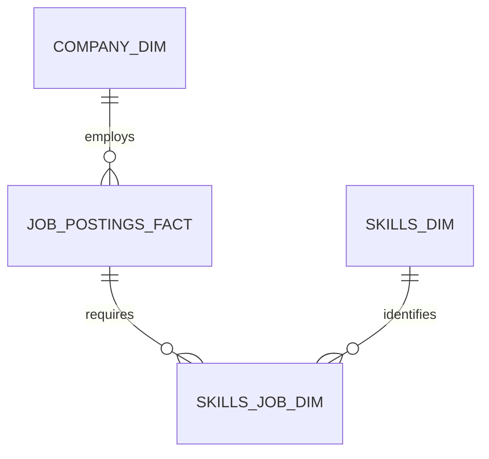

# Architecture and methods

Raw CSV → schema validation → exact deduplication → normalized composite deduplication → salary/remote/experience/skill transformation → four relational tables → SQL and Python analytics → Streamlit and exports.

The company dimension has a unique normalized name. Fact rows have a primary key and a company foreign key. The bridge primary key is (job_id, skill_id); a skill is counted once per posting. Country, company and date indexes support analytical access. SQLAlchemy builds a staging SQLite database inside a transaction. PRAGMA foreign_key_check must pass before publication. A complete version directory is published through an atomic current.json pointer. Failed validation leaves the pointer unchanged. Imports with the same checksum replace the same version rather than append duplicate records. Concurrent multiuser imports are not a supported deployment mode.

Global filters intersect dimensions, while multiselect values within one dimension use OR. Skill categories match at least one requested category. Salary range excludes missing salaries only when enabled. Date filters operate on observation dates. SQL Lab explicitly analyses the full snapshot, with a visible scope notice. Quality metrics describe the original snapshot rather than a misleading filtered raw dataset.

Salary resolution prefers salary_standardized, salary_yearly, salary_hourly × 2,080, then an annualized known-unit range midpoint. Unknown source currency prevents verified USD claims. The 15K–400K screen follows the PDF baseline but can remove legitimate part-time or very senior compensation. Excluded candidates and missing indicators remain available for audit. A nonmissing invalid primary source does not silently fall through to a lower-priority source.

Seniority is inferred from title keywords, with managerial keywords taking priority. Default Mid-Level is a methodological assumption rather than verified years of experience. Raw relative posted_at text cannot safely be anchored without source collection semantics; only observation-date trends are shown. Missing remote values are Unknown. Search targets cannot establish the actual global geography of jobs. No remote/onsite test is reported unless both explicitly identified groups contain 30 usable salaries.

Skill rankings show both demand and salary sample size. A salary ranking requires 30 salary observations. Optimal skills require 100 demand observations, 30 usable salaries and mean associated salary at least the overall salary median. These thresholds control small-sample noise, not confounding or causality. Skills can co-occur; category mention counts can exceed job counts.

Security: strict predefined SQL queries, read-only database connections, literal search rather than regex, safe literal skill parsing, upload size and required-column checks, no embedded credentials, and formula-leading strings escaped in Excel. Core functionality uses native Streamlit widgets. Uploads are authorized local operations; deploy behind authentication if exposed to untrusted users. The application binds to loopback by default.
